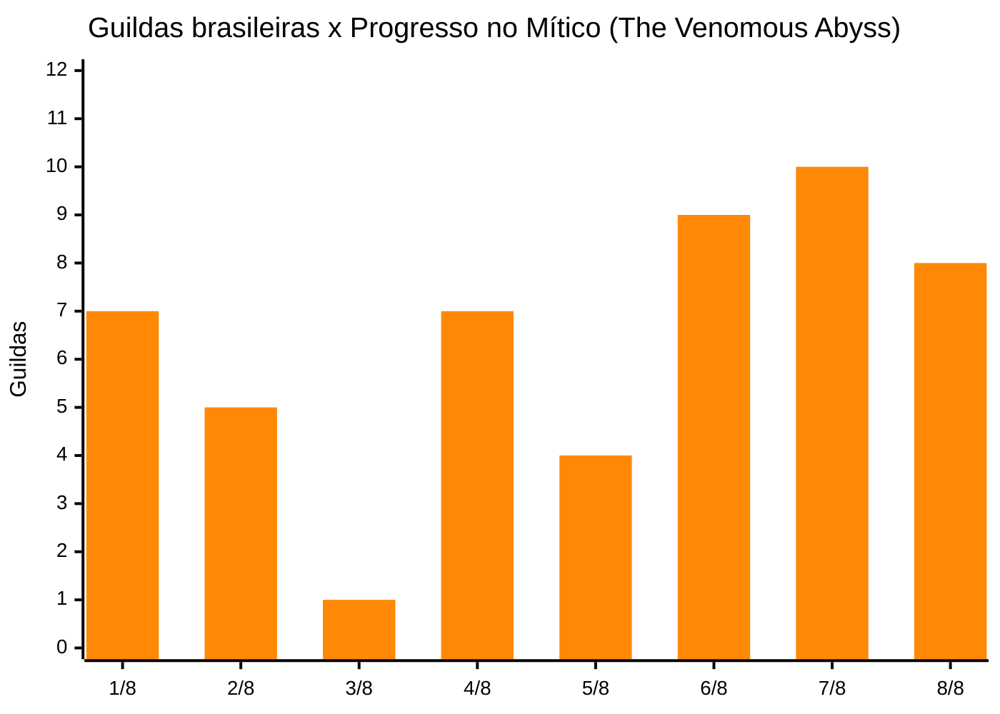

# 1. Documento de Escopo


O **LogCoach** transforma o log de combate do World of Warcraft, hoje um dado bruto, técnico e em inglês, em um diagnóstico em português: quais erros o jogador cometeu, quanto cada um custou e o que corrigir primeiro.


## Visão geral

| Item                  | Descrição                                                                                                                                                                                          |
| --------------------- | -------------------------------------------------------------------------------------------------------------------------------------------------------------------------------------------------- |
| **Nome do projeto**   | LogCoach                                                                                                                                                                                           |
| **Tipo de aplicação** | Web responsiva (funciona também no celular)                                                                                                                                                        |
| **Setor**             | Entretenimento e Esportes Eletrônicos (e-sports)                                                                                                                                                   |
| **Público-alvo**      | Jogadores competitivos brasileiros de World of Warcraft que gravam suas lutas no Warcraft Logs e querem melhorar o próprio desempenho                                                              |
| **Objetivo geral**    | Reduzir o tempo e o conhecimento técnico necessários para transformar um log de combate em informação útil, indicando em português os erros de maior impacto e a ordem em que devem ser corrigidos |

***


_Não joga World of Warcraft?_ Os termos do jogo e do LogCoach usados nesta documentação estão explicados no glossário abaixo.


<strong>O jogo</strong>

* _Chefe:_ inimigo principal de um encontro, mais forte que os demais, que exige coordenação do grupo para ser derrotado.
* _Dificuldade:_ nível de desafio de um chefe: Normal, Heroico e Mítico, do mais fácil ao mais difícil. Quanto maior, mais exigente a luta. O MVP analisa só a dificuldade Mítica.
* _Encontro:_ a luta contra um chefe específico, com regras e mecânicas próprias.
* _Expansão:_ grande atualização do jogo, com história, raides e masmorras novas. A expansão atual é Midnight.
* _Guilda:_ grupo organizado de jogadores que jogam juntos com frequência. No nível mais alto, as guildas competem como equipes, como na Race to World First.
* _JxJ (jogador contra jogador):_ modo em que jogadores enfrentam outros jogadores, em vez de chefes. É o modo disputado no AWC, em arenas: combates entre pequenas equipes de jogadores.
* _Masmorra:_ conteúdo para grupos de 5 jogadores, com uma sequência de inimigos e chefes.
* _Mítica+:_ modo competitivo das masmorras, com tempo limite e dificuldade que cresce a cada nível de chave. É a modalidade disputada no MDI. _Mítica+ alta_ são as chaves de nível mais alto, jogadas pelos jogadores mais competitivos.
* _Patch:_ atualização do jogo que pode mudar habilidades e números. Por isso, as regras do LogCoach ficam em arquivos que podem ser atualizados a cada patch.
* _Raide:_ conteúdo para grupos grandes, de até 30 jogadores, com uma sequência de chefes. Cada raide nova abre uma nova Race to World First.
* _Reino:_ servidor do jogo em que o personagem foi criado. No LogCoach, o personagem é identificado pelo nome e pelo reino.
* _Temporada:_ período dentro de uma expansão, com um conjunto próprio de raides e masmorras competitivas. The Venomous Abyss é a raide da Temporada 2 de Midnight.

<strong>Competições</strong>

* _AWC (Arena World Championship):_ campeonato mundial oficial de JxJ em arenas. Em 2026, distribui US$ 300 mil em prêmios na temporada.
* _BlizzCon:_ evento da Blizzard, empresa que desenvolve o World of Warcraft. Sediou a final global do MDI 2026, nos Estados Unidos.
* _MDI (Mythic Dungeon International):_ campeonato mundial oficial de Mítica+. Em 2026, teve US$ 300 mil em prêmios.
* _Race to World First:_ corrida entre as melhores guildas do mundo para derrotar primeiro o chefe final de cada raide nova, acompanhada ao vivo pela comunidade.

<strong>O recorte do MVP</strong>

* _Entombed Sentinels:_ segundo chefe na ordem de implementação, previsto para a versão beta. A raide se divide em dois grupos, um em cada chefe, e por isso a escolha de alvo pesa muito no dano.
* _Mago Arcano:_ especialização arcana da classe Mago e a única analisada no MVP. É a especialização que o especialista do grupo joga em alto nível.
* _Midnight:_ expansão atual do World of Warcraft.
* _Nek'zali, a Enrosca-almas_ (em inglês, Nek'zali the Soulcoiler)_:_ primeiro chefe suportado e o único analisado na versão alfa. A luta tem um alvo principal e fases bem marcadas, o que torna a comparação com os melhores logs mais justa.
* _The Lost Explorers:_ terceiro chefe na ordem de implementação, previsto para a versão beta. Três chefes lutam ao mesmo tempo, o que exige mais cuidado nas regras.
* _The Venomous Abyss:_ raide da Temporada 2 de Midnight e a única analisada no MVP. Foi nela que a Team Liquid venceu a Race to World First pela quinta vez seguida.

<strong>O personagem</strong>

* _Acúmulos (stacks):_ cargas de um efeito que se somam e o deixam mais forte. Algumas habilidades rendem mais quando usadas com mais acúmulos.
* _Buff:_ efeito positivo e temporário no personagem, como um aumento de dano.
* _Classe:_ tipo de personagem (por exemplo, Mago), que define o conjunto de habilidades disponíveis.
* _Especialização (spec):_ variação dentro de uma classe, com estilo de jogo e habilidades próprios. O Mago, por exemplo, tem as especializações Arcano, Fogo e Gelo.
* _Item level:_ número que mede a força do equipamento do personagem. Por isso, o LogCoach compara o jogador apenas com quem está na mesma faixa de item level (ver Bracket).
* _Poção:_ item consumível que dá um bônus temporário. O momento em que o jogador usa a segunda poção da luta é uma das métricas comparadas com os melhores.
* _Proc:_ efeito que ativa por chance ao usar uma habilidade, normalmente deixando a próxima mais forte ou gratuita. Proc perdido é o efeito que expira sem ser aproveitado.
* _Recurso:_ o que as habilidades gastam para serem usadas, como mana. Recurso desperdiçado é o que se perde sem virar dano.
* _Rotação:_ sequência e prioridade de habilidades que o jogador repete para causar o máximo de dano. Quem ainda está aprendendo a rotação básica fica fora do público do MVP.

<strong>A luta</strong>

* _Adds:_ inimigos secundários que aparecem durante a luta contra o chefe.
* _Cast:_ o uso de uma habilidade (lançar uma magia). Casts por minuto é quantas vezes a habilidade foi usada a cada minuto. O LogCoach compara por minuto porque a duração das fases muda de uma luta para outra.
* _Cooldown (CD):_ habilidade forte que, depois de usada, leva um tempo para ficar disponível de novo. Usá-la no momento errado do encontro desperdiça seu potencial.
* _Defensivos:_ habilidades que reduzem o dano recebido ou ajudam o jogador a não morrer. No LogCoach, o defensivo só é cobrado nos picos de dano em que duas mecânicas do chefe caem juntas (ver Overlap de mecânicas).
* _DPS (dano por segundo):_ principal medida de desempenho de quem causa dano. É o número que o LogCoach compara com a média dos melhores.
* _Escolha de alvo:_ decidir qual inimigo atacar quando há mais de um ao mesmo tempo. Em lutas com vários chefes ou adds, essa escolha muda muito o dano.
* _Fase:_ etapa da luta, com mecânicas próprias. Nos logs em inglês, as fases aparecem como Stage (por exemplo, Stage Two = Fase 2).
* _Golpe de raide:_ ataque do chefe que atinge o grupo inteiro de uma vez.
* _Intermissão:_ intervalo entre fases em que o chefe não pode ser atacado. O tempo parado durante a intermissão não conta como erro.
* _Janela de burst:_ momento da luta em que vale concentrar os cooldowns ofensivos para causar o máximo de dano, como o início de uma fase.
* _Kill:_ tentativa em que o chefe foi derrotado.
* _Log de combate:_ registro detalhado de uma luta, com cada habilidade usada, cada segundo parado e cada morte.
* _Mecânica:_ ação do chefe que o grupo precisa tratar, como um golpe em toda a raide ou uma troca de fase.
* _Overlap de mecânicas:_ quando duas mecânicas do chefe acontecem ao mesmo tempo, formando um pico de dano. É o momento em que se espera o uso de defensivo.
* _Tempo ativo:_ parte da luta em que o jogador está usando habilidades. É o contrário do tempo parado.
* _Tempo parado:_ período em que o jogador não está usando habilidades. Na prática, é desempenho perdido.
* _Tentativa (pull):_ cada vez que o grupo enfrenta o chefe, do início da luta até a vitória (kill) ou a derrota (wipe).
* _Wipe:_ tentativa em que o grupo inteiro morreu antes de derrotar o chefe.

<strong>Habilidades do Mago Arcano</strong>

* _Surto Arcano_ (em inglês, Arcane Surge)_:_ principal cooldown ofensivo do Mago Arcano. Nos melhores logs, é usado a cada 93 segundos, em média.
* _Toque dos Magos_ (em inglês, Touch of the Magi)_:_ cooldown que marca o alvo e, alguns segundos depois, causa um dano extra proporcional ao dano acumulado nele. Os melhores jogadores usam o Toque e o Surto Arcano com poucos segundos de diferença.

<strong>Termos do LogCoach</strong>

* _Jogador no Top 10:_ quando o log analisado já está no Top 10 do bracket, ele sai da comparação e entra o 11º colocado; o relatório reconhece a posição.
* _Bracket:_ faixa de item level usada pelo Warcraft Logs, de 3 em 3 níveis (por exemplo, 326–328). O LogCoach compara o jogador só com quem está no mesmo bracket, para que a diferença mostrada seja de execução, e não de equipamento.
* _Diferença não explicada:_ parte da diferença de dano de uma fase que nenhuma regra explica.
* _Ranking:_ lista dos melhores desempenhos em cada chefe e dificuldade, publicada pelo Warcraft Logs.
* _Regras da especialização:_ regras fixas que valem em qualquer luta, como tempo parado, uso de cooldowns, recurso desperdiçado, procs perdidos e mortes.
* _Regras do encontro:_ regras que descrevem cada chefe (fases, intermissões, janelas de burst e golpes de raide) e ajustam as regras da especialização.
* _Relatório (report):_ registro de uma sessão de raide enviado ao Warcraft Logs, com várias lutas. É o link desse relatório que o jogador cola no LogCoach.
* _Top 10 (tops):_ os 10 melhores logs de Mago Arcano no mesmo chefe, dificuldade e bracket do jogador. A média deles é a referência de comparação.

<strong>As ferramentas</strong>

* _ParsePal e WowCoach:_ ferramentas que usam IA para dar feedback automático. São genéricas para todas as classes e em inglês.
* _Raider.IO:_ site de pontuação e ranking de Mítica+. Não analisa a luta.
* _Warcraft Logs:_ site onde os jogadores enviam seus logs de combate para visualizá-los e compará-los em rankings. É a fonte dos dados analisados pelo LogCoach.
* _WoWAnalyzer:_ ferramenta gratuita que gera um checklist automático por especialização a partir do log. É em inglês e usa regras rígidas, que dão alerta falso por ignorar o contexto da luta.

***

## 1.1 Introdução e Contextualização

**Tipo de aplicação:** Web (responsiva, funciona no celular).

**Setor:** Entretenimento e Esportes Eletrônicos (e-sports).

World of Warcraft (WoW) é um jogo online em que grupos de 5 a 30 jogadores enfrentam chefes difíceis. No nível mais alto, isso virou competição de verdade, com torneios oficiais e premiação em dinheiro:



**Mythic Dungeon International (MDI)**&#x20;

Campeonato global de eSports de _World of Warcraft_ (WoW) organizado pela Blizzard Entertainment, focado em corrida de velocidade (_speedrunning_) de masmorras no modo Mítico+**.** A final global aconteceu na BlizzCon 2026, nos Estados Unidos, com **US$ 300 mil em prêmios**.

O valor da final é só a última etapa de um circuito que começa meses antes. Os times passam por uma eliminatória aberta, uma fase de grupos e uma final de temporada, cada uma com premiação própria. Somadas, as etapas distribuíram **US$ 490 mil** em 2026, e nenhum dos quatro times da final global era brasileiro ou latino-americano: o Brasil disputa pela região americana, contra as equipes dos Estados Unidos.

| Etapa do MDI 2026                    | Premiação            | 1º lugar    |
| ------------------------------------ | -------------------- | ----------- |
| Fase de grupos (3 grupos de 8 times) | US$ 30 mil por grupo | US$ 9 mil   |
| Final da temporada (8 times)         | US$ 100 mil          | US$ 40 mil  |
| Final global na BlizzCon (4 times)   | US$ 300 mil          | US$ 150 mil |

Fonte: Raider.IO, página "Prizes" do MDI BlizzCon 2026; finalistas: MMOs.com, 04/09/2026.



**Arena World Championship (AWC)**&#x20;

Representa o lado JxJ (jogador contra jogador) do jogo e também distribui **US$ 300 mil em prêmios** na temporada.

A final do AWC reuniu seis equipes no palco da BlizzCon, vindas da Europa, da América do Norte e da China. Assim como no MDI, nenhuma equipe da América Latina chegou à final, o que mostra que o Brasil ainda não tem presença no topo do e-sport oficial de WoW.

Fonte: Blizzard, "Unveiling the AWC & MDI Road to BlizzCon in 2026!"; Bolverk Games, 10/09/2026.&#x20;



**Race to World First**

Corrida entre as melhores guildas do mundo para derrotar primeiro o chefe final de cada raide nova. O evento é patrocinado por diversas grandes empresas de tecnologia e acompanhado ao vivo pela comunidade. Na raide atual, _The Venomous Abyss_, a **Team Liquid (time americano) venceu pela quinta vez seguida**.

A corrida de 2026 durou 16 dias. A linha do tempo abaixo mostra o tamanho do esforço: a guilda vencedora precisou de cerca de 311 tentativas só no chefe final, e a segunda colocada terminou apenas 26 minutos depois. É esse nível de detalhe na execução que separa as melhores guildas do mundo.



### 18/08 · A raide abre

The Venomous Abyss é liberada no Mítico e a corrida começa



### 30/08 · Penúltimo chefe

A Liquid derrota o Coiled Altar depois de 310 tentativas.



### 03/09 · World Firs

A Liquid derrota Ula'tek depois de cerca de 311 tentativas. A Echo termina 26 minutos depois.



### 13 e 14/10 · Hall of Fame completo

As 200 vagas para as primeiras guildas do mundo a derrotar o chefe final se esgotam



Fontes: LFCarry (atualizado em 16/11/2026); Method, cobertura ao vivo da corrida; MythicStats (dados do Warcraft Logs).&#x20;



***

Os cartões abaixo resumem o tamanho do cenário competitivo do WoW hoje. Os dois primeiros mostram o valor do jogo como e-sport: dinheiro em prêmios e público assistindo. O último mostra a raide Mítica, o modo que o LogCoach analisa: quantas guildas competem no mundo.

<table data-view="cards"><thead><tr><th></th><th></th><th></th><th data-hidden data-card-cover data-type="image">Cover image</th></tr></thead><tbody><tr><td><h4>US$ 600 mil</h4></td><td>em prêmios nas finais de MDI e AWC na BlizzCon 2026</td><td>Fonte: Blizzard</td><td><a href=".gitbook/assets/capa-premiacao-escuro.png">capa-premiacao-escuro.png</a></td></tr><tr><td><h4>465,8 milhões</h4></td><td>de horas de WoW assistidas na Twitch em 12 meses</td><td>Fonte: SullyGnome (nov/2025–nov/2026)</td><td><a href=".gitbook/assets/capa-audiencia-escuro.png">capa-audiencia-escuro.png</a></td></tr><tr><td><h4>5.792</h4></td><td>guildas no mundo mataram ao menos 1 chefe Mítico na raide atual</td><td>Fonte: Raider.IO (17/11/2026)</td><td><a href=".gitbook/assets/capa-guildas-escuro.png">capa-guildas-escuro.png</a></td></tr></tbody></table>

Chegar a esse nível exige mais do que horas de jogo. O jogador precisa **estudar o próprio desempenho**. Para isso, toda luta pode ser gravada em um **log de combate** e enviada ao site **Warcraft Logs**. O log registra cada habilidade usada, cada segundo em que o jogador ficou parado e cada morte.

O obstáculo é que esse log é um **dado bruto**: tabelas e gráficos que exigem horas de análise e muito conhecimento do jogo para virar informação útil. A informação necessária para evoluir já existe, mas não está pronta para ser usada.

***


**Recorte brasileiro:** o Brasil tem comunidade própria no jogo desde 2011, com servidores nacionais e fórum oficial em português. Mesmo assim, quase todo o conteúdo avançado (guias, ferramentas e análises) está em inglês.


A cena brasileira de raide Mítica existe e é competitiva, mas é pequena perto do resto do mundo e ainda está longe do topo. Os números abaixo mostram esse retrato na temporada atual.


{% column width="33.33333333333333%" %}
**51 guildas brasileiras**

Fazem raide Mítica na temporada atual. Só **8** completaram a raide.


{% column width="66.66666666666667%" %}
As 51 guildas representam **0,9%** das 5.792 guildas Míticas do mundo. A melhor delas, a Perma Desvantagem, está em **218º** lugar no ranking mundial, enquanto só as 200 primeiras guildas a derrotar o chefe final entram no Hall of Fame. Como cada guilda de raide Mítica tem 20 jogadores, a cena brasileira reúne pelo menos cerca de 1.000 jogadores, número estimado pelo grupo a partir do ranking.

Fonte: Raider.IO, consultado em 17/11/2026. O filtro "Brasil" conta as guildas dos servidores brasileiros.



***

O gráfico mostra quantas guildas brasileiras pararam em cada etapa da raide, do primeiro ao oitavo chefe. A maior parte está no meio do caminho, entre o 4º e o 7º chefe: são guildas que já jogam no nível mais alto, mas ainda não conseguem fechar a raide. É exatamente o público em que uma análise mais fina de cada jogador pode fazer diferença.

Fonte: Raider.IO, rankings de The Venomous Abyss no Mítico (Brasil, EUA/Oceania, Europa e mundo), consultados em 17/11/2026.

***

### O que é o LogCoach ?

O LogCoach é uma ferramenta de análise de desempenho criada para jogadores brasileiros profissionais de World of Warcraft. Ela usa os dados do Warcraft Logs, a plataforma de registro de combate que a comunidade competitiva já adota, para comparar a execução de cada jogador com a da elite mundial e apontar em português, de forma clara e objetiva, onde ele está perdendo desempenho e o que precisa ajustar.

O diagnóstico combina regras de análise determinísticas, que garantem precisão e transparência, com uma camada de inteligência artificial que transforma os números em orientações práticas. O MVP começa pelo Mago Arcano no chefe Nek’zali, um encontro em que a diferença entre os jogadores está na execução individual.

O objetivo é encurtar a distância entre a cena brasileira e o topo mundial: hoje só 51 guildas do Brasil derrotaram ao menos um chefe Mítico na raide atual, e a melhor delas está na 218ª posição do mundo.

***

## 1.2 Identificação e Descrição do Problema

### Contexto e impacto

O jogador competitivo que quer melhorar tem três caminhos hoje, e todos têm custo alto:

| Caminho                                         | Problema                                                                   |
| ----------------------------------------------- | -------------------------------------------------------------------------- |
| Analisar o log sozinho no Warcraft Logs         | Leva horas por luta e exige saber exatamente o que procurar                |
| Usar ferramentas automáticas (ex.: WoWAnalyzer) | Checklists rígidos, que dão alerta falso porque ignoram o contexto da luta |
| Pagar um coach humano                           | Caro, depende de agenda, quase sempre em inglês                            |

Esse custo aparece em três dimensões:



São horas de análise manual que poderiam ser horas de prática. Cada sessão gasta interpretando um log é uma sessão a menos de treino dentro do jogo.



Erros finos passam despercebidos, como usar uma habilidade no momento errado do encontro ou ficar parado sem lançar magia. Como não são identificados, se repetem semana após semana.



O jogador brasileiro que não domina inglês técnico fica para trás, porque não tem acesso à maior parte do material avançado do jogo, que é produzido em inglês.



A barreira não está no jogo em si. Desde 2011 o World of Warcraft tem cliente traduzido para o português, o 9º idioma oficial do jogo e o 3º da América Latina. O que continua em inglês é o material para quem quer jogar no nível mais alto: guias, ferramentas de análise e conteúdo dos melhores jogadores.

Fonte: Engadget, 22/07/2011, citando o comunicado oficial da Blizzard.&#x20;

***

### Evidências do problema



#### Relato de especialista do grupo

**Arthur**, integrante do grupo, joga de **Mago Arcano** e está entre o **1% melhor** da base de jogadores.

Mesmo nesse patamar, Arthur relata não encontrar conteúdo avançado específico da sua especialização. Ele também aponta que o WoWAnalyzer marca como erros ações que, no contexto daquela luta, não são erros. A análise automática genérica, portanto, não só deixa de ajudar: pode levar o jogador a "corrigir" o que estava certo.

Os colegas de jogo de Arthur confirmam a dificuldade de analisar o registro e extrair dele informação útil. Com isso, evoluir exige não só mais tempo, mas também muito mais repetições até que o erro seja percebido e corrigido.



#### Mercado

Já existem ferramentas de análise, do Warcraft Logs ao WoWAnalyzer e a soluções com IA como ParsePal e WowCoach, mas todas em inglês. As automáticas aplicam regras rígidas ou genéricas, sem considerar o contexto da luta. Nenhuma é focada no jogador brasileiro, e as que trazem informações avançadas não fazem isso de forma intuitiva e fácil de digerir.

Essa ausência chama atenção pelo tamanho do público. O Brasil é o **3º país do mundo em número de jogadores** de videogame, com 123,3 milhões de pessoas, e o **9º em receita**, com US$ 2,7 bilhões em 2025. Mesmo assim, nenhuma ferramenta de análise de log é pensada para ele.

Fonte: Newzoo, citada pelo PocketGamer.biz em 29/04/2026.



#### Premiações

Torneios com US$ 300 mil em prêmios mostram que desempenho no WoW tem valor real e não é só lazer. Para quem compete, cada melhoria de desempenho tem impacto concreto.

Somando os dois campeonatos oficiais, as finais na BlizzCon 2026 distribuíram **US$ 600 mil**. O detalhe por competição está abaixo.

| Competição | Etapa                   | Premiação                         |
| ---------- | ----------------------- | --------------------------------- |
| MDI        | Fase de grupos          | US$ 90 mil (US$ 30 mil por grupo) |
| MDI        | Final da temporada      | US$ 100 mil                       |
| MDI        | Final global (BlizzCon) | US$ 300 mil                       |
| AWC        | Final (BlizzCon)        | US$ 300 mil                       |

Fontes: Raider.IO (prêmios do MDI); Blizzard (AWC e total da BlizzCon).



#### Distância até o topo

Os dados de raide mostram onde o jogador brasileiro está. Das 804 guildas do mundo que completaram a raide atual no Mítico, só **8** são brasileiras, e a melhor delas está em **218º** lugar, logo atrás das 200 vagas do Hall of Fame. O Brasil já tem guildas no nível mais alto; o que falta é o ajuste fino de desempenho para subir no ranking, que é o que o LogCoach entrega.

Fonte: Raider.IO, consultado em 17/11/2026.



#### Pesquisa com jogadores (em andamento)

Formulário com jogadores brasileiros sobre o tempo gasto analisando logs, as ferramentas usadas, a dificuldade com o inglês e o interesse no produto. A pesquisa está em andamento; o resumo das respostas entra aqui quando ela for concluída.



***

### Relação com princípios de usabilidade

O problema central do LogCoach é de **usabilidade**: a informação existe, mas está em um formato difícil de usar. O jogador já tem acesso aos dados. O que falta é chegar ao que importa sem horas de análise e sem domínio de inglês técnico. 

O que diz a ABNT NBR ISO 9241-11

A norma define usabilidade como a medida em que um produto pode ser usado por usuários específicos para atingir objetivos específicos com **eficácia**, **eficiência** e **satisfação**, em um contexto de uso específico.

Aplicado ao problema:

* **Eficácia:** o jogador consegue descobrir o que corrigir? Hoje, erros finos passam despercebidos e a análise genérica aponta falsos erros.
* **Eficiência:** com quanto esforço? Hoje, horas de análise manual e muito conhecimento técnico.

A tabela abaixo reúne os princípios de usabilidade (heurísticas de Nielsen) mais críticos para este problema: como cada um falha hoje e como o LogCoach responde.

| Princípio (Nielsen)                       | Como o problema aparece hoje           | O que o LogCoach faz                           |
| ----------------------------------------- | -------------------------------------- | ---------------------------------------------- |
| **H1 · Visibilidade do status**           | Sem retorno de "estou melhorando?"     | Histórico de análises e evolução               |
| **H2 · Correspondência com o mundo real** | Termos técnicos e em inglês            | Feedback em português, na linguagem do jogador |
| **H6 · Reconhecer em vez de lembrar**     | O jogador precisa saber o que procurar | O sistema já diz onde olhar                    |
| **H8 · Design estético e minimalista**    | Dezenas de tabelas e gráficos          | Mostra primeiro os erros que mais custam       |

***

## 1.3 Proposta de Solução

O LogCoach começa com uma ação simples: **o jogador cola o link do seu log do Warcraft Logs**. A partir daí, o sistema executa três etapas:



#### Busca dos dados

O LogCoach busca os dados da luta pela API oficial do Warcraft Logs. O jogador não precisa baixar nem enviar nenhum arquivo.



#### Comparação com os melhores

A luta é comparada com a média dos 10 melhores logs do mesmo chefe e da mesma dificuldade, na mesma faixa de item level do jogador. Assim, o jogador é medido contra quem enfrentou o mesmo desafio com equipamento equivalente.



#### Regras da especialização

O sistema aplica regras fixas da especialização e avalia quatro pontos: tempo parado, uso de cooldowns, uso de defensivos e mortes.





**Dados e regras encontram os erros.** A identificação dos erros vem de dados reais (a comparação com os melhores logs) e de regras fixas da especialização.


***

### Funcionalidades principais

| Funcionalidade             | O que entrega ao jogador                                                |
| -------------------------- | ----------------------------------------------------------------------- |
| **Análise por link**       | Análise a partir do link do Warcraft Logs, sem precisar baixar arquivo  |
| **Relatório priorizado**   | Erros que mais custaram desempenho, do maior para o menor impacto       |
| **Comparação lado a lado** | Desempenho do jogador ao lado da média dos melhores jogadores           |
| **Histórico e evolução**   | Acompanhamento da evolução ao longo do tempo, para usuários cadastrados |

***

### Planos



**Grátis**

5 análises por mês.



**Pago**

Análises ilimitadas.



***

## 1.4 Justificativa da Arquitetura: Web


**Decisão:** aplicação Web responsiva.


A escolha parte do contexto real de uso. O jogador já está no computador quando o log é gerado e enviado, e a única entrada de que o LogCoach precisa é um link.

| Critério                | Análise                                                                                                                     |
| ----------------------- | --------------------------------------------------------------------------------------------------------------------------- |
| **Perfil do usuário**   | O jogador está no computador, onde o jogo roda e onde o log é enviado. O fluxo natural é copiar o link e colar no navegador |
| **Hardware necessário** | Nenhum recurso de celular é necessário (GPS, câmera). Só internet                                                           |
| **Distribuição**        | Basta um link, sem loja de aplicativos e sem instalação. Fácil de compartilhar em Discord de guilda                         |
| **Uso no celular**      | O layout responsivo permite rever o relatório no celular depois                                                             |

Além disso, os dados vêm da API oficial do Warcraft Logs, que é uma integração web. Assim, todo o fluxo, da origem do log ao relatório final, acontece dentro do navegador.

A escolha vem do próprio fluxo de uso:

* **A entrada é um link de site.** O jogador pega o link do log no Warcraft Logs, que é um site, e cola no LogCoach.
* **A integração é web.** Os dados vêm da API oficial do Warcraft Logs.
* **Nenhum recurso de hardware é necessário.** A solução não depende de GPS, câmera ou outros recursos do aparelho.
* **Acesso em qualquer tela.** Por ser responsiva, a aplicação também funciona no celular, sem instalação.

***

## 1.5 Fontes de Pesquisa e Referências

Benchmarking

| Ferramenta                                       | O que faz                                       | Limite                                  |
| ------------------------------------------------ | ----------------------------------------------- | --------------------------------------- |
| **Warcraft Logs**                                | Guarda e mostra os logs, com rankings           | Dado bruto, a análise é manual          |
| **WoWAnalyzer**                                  | Checklist automático por especialização, grátis | Regras rígidas, alerta falso, inglês    |
| **Raider.IO**                                    | Pontuação e ranking de Mítica+                  | Não analisa a luta                      |
| **Ferramentas com IA** (ex.: ParsePal, WowCoach) | Feedback automático com IA                      | Genéricas para todas as classes, inglês |

O mercado se divide em dois grupos:

* Ferramentas que **guardam e ranqueiam** dados (Warcraft Logs, Raider.IO). Elas deixam toda a interpretação para o jogador.
* Ferramentas que **analisam** (WoWAnalyzer e soluções com IA). Elas automatizam a análise, mas com regras rígidas ou abordagem genérica, e em inglês.


**Diferencial do LogCoach:** especialista em uma especialização, em português e focado em dizer o que corrigir primeiro.


### Dados do cenário competitivo 

Os números usados nesta documentação vêm de uma pesquisa feita pelo grupo em 17/11/2026. A tabela abaixo reúne os principais, com a fonte de cada um. Os rankings do Raider.IO e os números da Twitch mudam com o tempo, por isso a data da consulta acompanha cada dado.

Dados de mercado e da cena competitiva

<table data-search="false"><thead><tr><th>Dado</th><th>Valor</th><th>Fonte</th></tr></thead><tbody><tr><td>Guildas brasileiras com ao menos 1 chefe Mítico na raide atual</td><td>51</td><td>Raider.IO, 17/11/2026</td></tr><tr><td>Guildas brasileiras que completaram a raide no Mítico</td><td>8 (de 804 no mundo)</td><td>Raider.IO, 17/11/2026</td></tr><tr><td>Melhor guilda brasileira</td><td>Perma Desvantagem, 218º do mundo</td><td>Raider.IO, 17/11/2026</td></tr><tr><td>Guildas no mundo com ao menos 1 chefe Mítico</td><td>5.792</td><td>Raider.IO, 17/11/2026</td></tr><tr><td>Prêmios nas finais de MDI e AWC (BlizzCon 2026)</td><td>US$ 600 mil</td><td>Blizzard</td></tr><tr><td>Race to World First de The Venomous Abyss</td><td>Liquid, 16 dias, ~311 tentativas no chefe final</td><td>LFCarry, Method</td></tr><tr><td>Horas de WoW assistidas na Twitch</td><td>465,8 milhões em 12 meses</td><td>SullyGnome</td></tr><tr><td>Pico de audiência da BlizzCon 2026</td><td>1,76 milhão de espectadores</td><td>Streams Charts</td></tr><tr><td>Brasil no mercado mundial de jogos</td><td>3º em jogadores (123,3 milhões), 9º em receita (US$ 2,7 bilhões)</td><td>Newzoo</td></tr><tr><td>Brasileiros que jogam</td><td>75,3%; 21,1% preferem o PC</td><td>Pesquisa Game Brasil 2026</td></tr><tr><td>Times brasileiros nas finais de MDI e AWC 2026</td><td>Nenhum</td><td>Raider.IO, MMOs.com</td></tr></tbody></table>

### Referências (ABNT)

Referências

BLIZZARD ENTERTAINMENT. **The Mythic Dungeon International returns!** 2026. Disponível em: [https://worldofwarcraft.blizzard.com/news/24276958](https://worldofwarcraft.blizzard.com/news/24276958). Acesso em: 12 out. 2026.

BLIZZARD ENTERTAINMENT. **Curse of Ula'tek: The Venomous Abyss raid goes live August 18**. 2026. Disponível em: [https://worldofwarcraft.blizzard.com/news/24294062](https://worldofwarcraft.blizzard.com/news/24294062). Acesso em: 12 out. 2026.

INTERNATIONAL ORGANIZATION FOR STANDARDIZATION. **ISO 9241-11:2018**: ergonomics of human-system interaction — part 11: usability: definitions and concepts. Genebra: ISO, 2018.

KRUG, S. **Não me faça pensar**: atualizado. Rio de Janeiro: Alta Books, 2014.

NIELSEN, J. **10 usability heuristics for user interface design**. Nielsen Norman Group, 1994. Disponível em: [https://www.nngroup.com/articles/ten-usability-heuristics/](https://www.nngroup.com/articles/ten-usability-heuristics/). Acesso em: 12 out. 2026.

NORMAN, D. A. **O design do dia a dia**. Rio de Janeiro: Rocco, 2006.

TECMUNDO. **World of Warcraft**: como migrar para um servidor brasileiro? 2011. Disponível em: [https://www.tecmundo.com.br/jogos/16654-world-of-warcraft-como-migrar-para-um-servidor-brasileiro-.htm](https://www.tecmundo.com.br/jogos/16654-world-of-warcraft-como-migrar-para-um-servidor-brasileiro-.htm). Acesso em: 12 out. 2026.

WARCRAFT LOGS. **API v2 documentation**. Disponível em: [https://www.warcraftlogs.com/v2-api-docs/warcraft/](https://www.warcraftlogs.com/v2-api-docs/warcraft/). Acesso em: 12 out. 2026.

WOWHEAD. **Unveiling the AWC and MDI road to BlizzCon in 2026**. 2026. Disponível em: [https://www.wowhead.com/news=380845](https://www.wowhead.com/news=380845). Acesso em: 12 out. 2026.

ENGADGET. **Fully localized WoW launching in Brazil**. 22 jul. 2011. Disponível em: [https://www.engadget.com/2011/07/22/fully-localized-wow-launching-in-brazil/](https://www.engadget.com/2011/07/22/fully-localized-wow-launching-in-brazil/). Acesso em: 17 nov. 2026.

FORBES BRASIL. **Consumo de games estabiliza e jogadores se preocupam com uso de IA no desenvolvimento**. 9 abr. 2026. Disponível em: [https://forbes.com.br/forbes-tech/2026/04/consumo-de-games-estabiliza-e-jogadores-se-preocupam-com-uso-de-ia-no-desenvolvimento/](https://forbes.com.br/forbes-tech/2026/04/consumo-de-games-estabiliza-e-jogadores-se-preocupam-com-uso-de-ia-no-desenvolvimento/). Acesso em: 17 nov. 2026.

LFCARRY. **WoW Race to World First 2026**. 2026. Disponível em: [https://lfcarry.com/guides/wow-race-to-world-first](https://lfcarry.com/guides/wow-race-to-world-first). Acesso em: 17 nov. 2026.

MEIO & MENSAGEM. **Após pico, número de jogadores brasileiros cai, segundo PGB**. 9 abr. 2026. Disponível em: [https://www.meioemensagem.com.br/marketing/apos-pico-numero-de-jogadores-brasileiros-cai-segundo-pgb](https://www.meioemensagem.com.br/marketing/apos-pico-numero-de-jogadores-brasileiros-cai-segundo-pgb). Acesso em: 17 nov. 2026.

METHOD. **Raid progress**: The Venomous Abyss. 2026. Disponível em: [https://www.method.gg/raidprogress](https://www.method.gg/raidprogress). Acesso em: 17 nov. 2026.

MMOS.COM. **WoW MDI 2026 Grand Finals teams and schedule**. 4 set. 2026. Disponível em: [https://mmos.com/news/mmorpg-news/wow-mdi-2026-grand-finals](https://mmos.com/news/mmorpg-news/wow-mdi-2026-grand-finals). Acesso em: 17 nov. 2026.

MYTHICSTATS. **Top guilds mythic raid progression**. Disponível em: [https://mythicstats.com/raid-top](https://mythicstats.com/raid-top). Acesso em: 17 nov. 2026.

POCKETGAMER.BIZ. **Brazil wants to produce games, not just consume them, as Gamescom Latam 2026 kicks off**. 29 abr. 2026. Disponível em: [https://www.pocketgamer.biz/brazil-wants-to-produce-games-not-just-consume-them-as-gamescom-latam-2026-kicks-off/](https://www.pocketgamer.biz/brazil-wants-to-produce-games-not-just-consume-them-as-gamescom-latam-2026-kicks-off/). Acesso em: 17 nov. 2026.

RAIDER.IO. **MDI BlizzCon 2026**: prizes. 2026. Disponível em: [https://raider.io/events/mdi-blizzcon-2026/prizes](https://raider.io/events/mdi-blizzcon-2026/prizes). Acesso em: 17 nov. 2026.

RAIDER.IO. **The Venomous Abyss**: Mythic rankings. Disponível em: [https://raider.io/the-venomous-abyss/rankings/brazil/mythic/0](https://raider.io/the-venomous-abyss/rankings/brazil/mythic/0). Acesso em: 17 nov. 2026.

STREAMS CHARTS. **BlizzCon 2026**: 1.76M viewers. 14 set. 2026. Disponível em: [https://streamscharts.com/news/blizzcon-2026-viewership-stats](https://streamscharts.com/news/blizzcon-2026-viewership-stats). Acesso em: 17 nov. 2026.

SULLYGNOME. **World of Warcraft Twitch stats over the past 365 days**. Disponível em: [https://sullygnome.com/game/World\_of\_Warcraft/365/summary](https://sullygnome.com/game/World_of_Warcraft/365/summary). Acesso em: 17 nov. 2026.

***

## 1.6Limitações (fora do escopo)

Para entregar uma análise de fato especializada, o LogCoach tem um escopo propositalmente restrito nesta versão. O que fica dentro e o que fica fora:



**✅ Dentro do escopo**

* Especialização **Mago Arcano**
* Lutas contra **chefes de raide**, comparadas por chefe e dificuldade
* Análise a partir do **link do Warcraft Logs**
* Feedback em **português**
* Aplicação **web responsiva**



**❌ Fora do escopo**

* Outras especializações e classes
* Modo JxJ (arenas)
* Masmorras Mítica+
* Envio de arquivo de log
* Logs privados ou inacessíveis pelo link
* Outros idiomas
* Aplicativo móvel nativo
* Análise em tempo real, durante a luta




**O recorte é a estratégia, não uma fraqueza.** As ferramentas atuais cobrem todas as classes e, por isso, aplicam regras rígidas que dão alerta falso fora do contexto da luta. Concentrar o LogCoach em uma única especialização é o que permite ter regras que entendem esse contexto, validadas por um jogador que está entre o 1% melhor dessa especialização.


**Por que cada item fica fora**

Outras especializações e classes

O diferencial do LogCoach é ser especialista em uma especialização. As regras fixas de análise (tempo parado, uso de cooldowns, uso de defensivos e mortes) são próprias de cada especialização, e as do Mago Arcano são validadas pelo especialista do grupo. Incluir novas especializações exigiria escrever novas regras e ter alguém com domínio delas para validá-las.

Modo JxJ (arenas)

O LogCoach compara a luta do jogador com os melhores logs do mesmo chefe e da mesma dificuldade. No JxJ, modo disputado no AWC, o adversário são outros jogadores. Não existe chefe nem dificuldade fixa que sirva de base de comparação.

Envio de arquivo de log

A análise parte do link do Warcraft Logs, e os dados são buscados pela API oficial. O jogador não precisa baixar nem enviar nenhum arquivo, e essa simplicidade faz parte da proposta.

Logs privados ou inacessíveis pelo link

O LogCoach depende dos dados que a API oficial do Warcraft Logs disponibiliza a partir do link. Logs que não estejam acessíveis por esse caminho não podem ser analisados. Nesses casos, o sistema informa claramente o motivo e o que o jogador pode fazer (heurística 9: ajudar o usuário a reconhecer e se recuperar de erros).

Outros idiomas

O problema que o LogCoach resolve é justamente a barreira do inglês para o jogador brasileiro. Todo o feedback é em português.

Aplicativo móvel nativo

A plataforma escolhida é web responsiva. O jogador já está no computador quando envia o log, e o uso no celular é atendido pelo layout responsivo, sem instalação.

Análise em tempo real, durante a luta

O fluxo do LogCoach começa depois da luta: o log já foi enviado ao Warcraft Logs e o jogador cola o link. O sistema analisa lutas concluídas e não acompanha a luta enquanto ela acontece.

