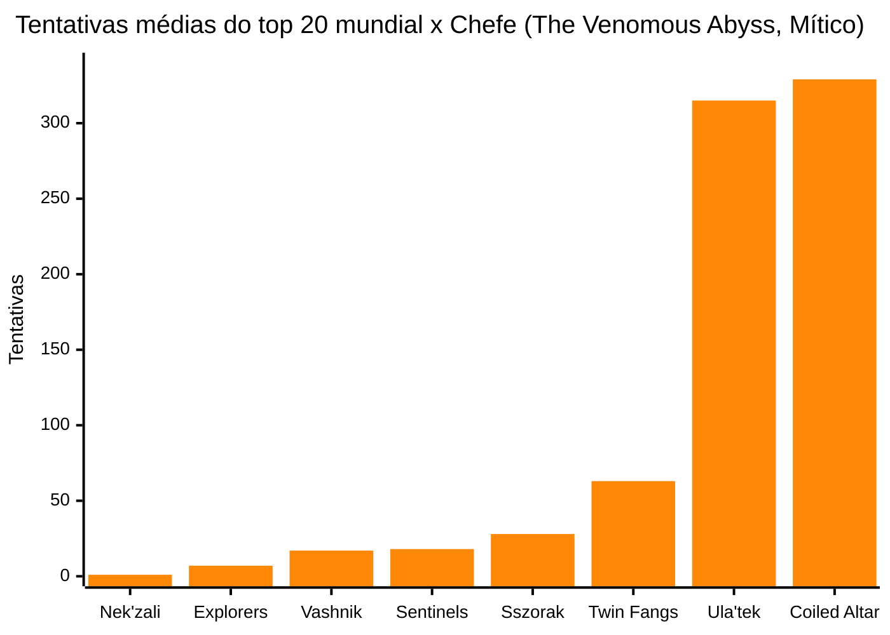

# 2. Planejamento Estratégico do Produto


Esta página registra como o LogCoach evoluiu depois da RT01: o feedback recebido, o recorte do MVP, e o roadmap até a banca.


### 2.1 Feedback incorporado após a RT01

<table><thead><tr><th width="335.25">Feedback do professor</th><th width="402.75">Mudança no escopo</th></tr></thead><tbody><tr><td><strong>Focar no jogador competitivo, de alto nível</strong></td><td>Público definido como quem joga raide Heroica/Mítica e Mítica+ alta. Quem está aprendendo a rotação básica fica fora do MVP</td></tr><tr><td><strong>Destacar as premiações para mostrar valor</strong></td><td>O contexto do projeto abre com MDI e AWC 2026 (US$ 300 mil cada) e com a Race to World First</td></tr><tr><td><strong>Focar no público brasileiro no MVP</strong></td><td>Interface e relatório só em português. Inglês fica para depois</td></tr></tbody></table>


**Resultado:** o LogCoach ficou mais estreito e mais profundo. Em vez de atender qualquer jogador, atende quem já joga em alto nível e precisa de análise fina, em português.


***

### 2.2 Recorte do MVP

Para que a análise seja realmente especializada já na primeira versão, o MVP foi recortado em uma especialização, uma raide, três chefes e duas dificuldades:

<table data-search="false"><thead><tr><th width="192.75">Item</th><th width="545.25">Decisão</th></tr></thead><tbody><tr><td><strong>Especialização</strong></td><td>Mago Arcano</td></tr><tr><td><strong>Conteúdo</strong></td><td>Raide The Venomous Abyss (Midnight, Temporada 2)</td></tr><tr><td><strong>Chefes</strong></td><td>1º Nek'zali the Soulcoiler, 2º Entombed Sentinels, 3º The Lost Explorers</td></tr><tr><td><strong>Dificuldade</strong></td><td>Mítico</td></tr><tr><td><strong>Entrada</strong></td><td>Link do relatório no Warcraft Logs</td></tr><tr><td><strong>Comparação</strong></td><td>Média dos 10 melhores logs de Mago Arcano no mesmo chefe e dificuldade, na mesma faixa de item level do jogador</td></tr><tr><td><strong>Idioma</strong></td><td>Português</td></tr><tr><td><strong>Camada de IA</strong></td><td>Fora do MVP. O plano era usar o Gemini (Vertex AI) para transformar os números em orientações; saiu em 21/11 pelo custo financeiro da API, sem verba no projeto. Os erros e o que fazer vêm em textos prontos em português, montados pelo motor</td></tr></tbody></table>

#### Ordem dos chefes

A ordem de implementação segue a complexidade de cada luta. Quanto mais alvos ao mesmo tempo, mais a escolha de alvo influencia o dano, e mais cuidado as regras de comparação exigem.

<table><thead><tr><th width="70.25">Ordem</th><th width="130.25">Chefe</th><th width="209.75">Como é a luta</th><th width="320.25">Impacto na análise</th></tr></thead><tbody><tr><td><strong>1º</strong></td><td>Nek'zali the Soulcoiler</td><td>Um alvo principal, com fases bem marcadas</td><td>Comparação com os melhores logs mais justa.</td></tr><tr><td><strong>2º</strong></td><td>Entombed Sentinels</td><td>A raide se divide em dois grupos, um em cada chefe</td><td>A escolha de alvo muda muito o dano; as regras precisam de mais cuidado</td></tr><tr><td><strong>3º</strong></td><td>The Lost Explorers</td><td>Três chefes ao mesmo tempo</td><td>A escolha de alvo muda muito o dano; as regras precisam de mais cuidado</td></tr></tbody></table>


**Por que Nek'zali primeiro:** com um alvo principal e fases bem marcadas, a comparação com os 10 melhores logs fica mais justa. É o cenário ideal para validar o método antes de partir para as lutas com vários alvos.


Os dados da corrida confirmam essa escolha. O gráfico abaixo mostra quantas tentativas, em média, as 20 melhores guildas do mundo precisaram para derrotar cada chefe da raide no Mítico. No Nek'zali foi **uma tentativa**, contra mais de **300** nos dois últimos chefes. Ou seja, no Nek'zali a mecânica da luta não é o que separa os jogadores; o que separa é a execução individual de cada um, que é exatamente o que o LogCoach mede quando compara o jogador com os 10 melhores logs.

Fonte: MythicStats, seção "Average stats" (dados do Warcraft Logs), consultado em 17/11/2026.

***

### 2.3 Roadmap



#### Alfa · RT03 (04/11/2026, adiada de 28/10 pelo professor)

Análise elaborada da luta contra Nek'zali e histórico de análises. **Entregue:** o motor de análise real entrou na `main` em 04/11 (PR #27).



#### Beta · Banca / Expo Una (nov/2026)

Inclusão dos chefes Entombed Sentinels e The Lost Explorers e teste com jogadores.

**Situação na banca:** entra o Nek'zali completo, com o motor real e o site publicado (item 13). Os outros dois chefes ficaram para depois do MVP: o tempo foi para a precisão do primeiro chefe (DPS oficial do Warcraft Logs, desconto do Evocador Aumentação, defensivo pelos picos de dano), que é o que separa o LogCoach das ferramentas genéricas. Era o plano B previsto no item 6.4. Cada chefe é um arquivo YAML em `backend/app/encounters/`, então um chefe novo pede escrever e validar as regras nos logs, sem mudar o motor (RNF12).



#### Pós-MVP · 2027

Mais especializações, Mítica+, versão em inglês e pagamento real.

A versão em inglês tem um público medido: só na temporada atual, 1.696 guildas fazem raide Mítica na região americana e 2.459 na Europa, contra 51 no Brasil (Raider.IO, 17/11/2026). Com o método validado em português, abrir o produto para esses jogadores multiplica o mercado sem mudar o motor.


