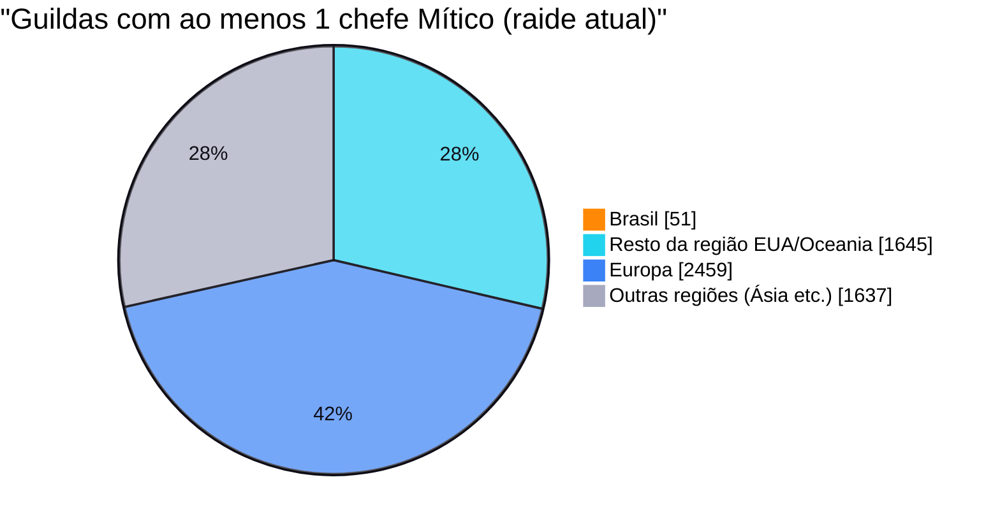
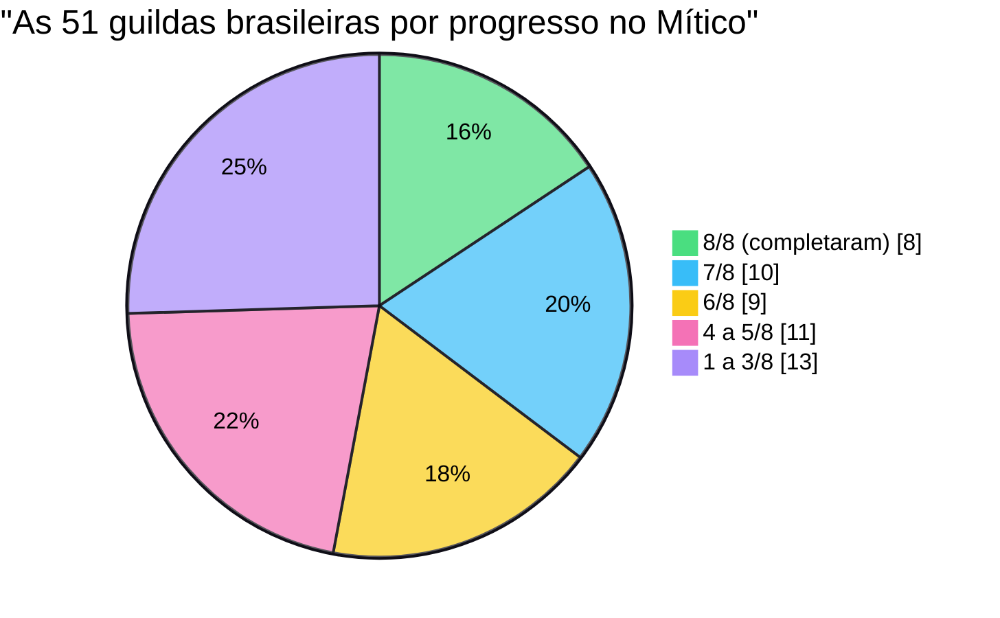

# 2.B. Documento de Visão do Produto (Product Vision Board)

## Visão

Fazer o jogador brasileiro competitivo de World of Warcraft evoluir mais rápido, transformando o log de combate em poucas correções claras, na sua língua.

## Frase de posicionamento

Para jogadores brasileiros de WoW que competem em alto nível, que perdem horas tentando entender seus logs, o LogCoach é um coach de desempenho web que aponta em português os erros que mais custam dano, reduzindo drasticamente o tempo de análise. Diferente do WoWAnalyzer, que gera checklists rígidos em inglês, nosso produto compara a luta com os melhores jogadores do mundo e explica o que corrigir primeiro.



## Público e mercado em números 

A visão do produto se apoia em três recortes de dados: o público que o LogCoach atende hoje, o mercado brasileiro de jogos em que ele está e a cena mundial para onde ele pode crescer. As abas abaixo resumem cada um.



* 51 guildas brasileiras fazem raide Mítica na temporada atual, o que dá pelo menos cerca de 1.000 jogadores (20 por guilda; estimativa do grupo).
* 8 guildas brasileiras completaram a raide no Mítico.
* A melhor guilda brasileira está em 218º lugar no mundo.

Fonte: Raider.IO, consultado em 17/11/2026.



* O Brasil é o 3º país do mundo em jogadores (123,3 milhões) e o 9º em receita (US$ 2,7 bilhões em 2025).
* 75,3% dos brasileiros jogam, e 21,1% preferem jogar no PC.

Fontes: Newzoo, via PocketGamer.biz (29/04/2026); Pesquisa Game Brasil 2026.



* 5.792 guildas no mundo fazem raide Mítica na temporada atual.
* US$ 600 mil em prêmios nas finais de MDI e AWC na BlizzCon 2026.
* 465,8 milhões de horas de WoW assistidas na Twitch em 12 meses.

Fontes: Raider.IO (17/11/2026); Blizzard; SullyGnome.



O gráfico mostra o peso de cada região entre as guildas que fazem raide Mítica. O Brasil é tão pequeno que não aparece nas proporções do gráfico, o que confirma a estratégia do MVP: atender a fundo um público pequeno e exigente, que hoje não tem ferramenta em português, antes de disputar o mercado maior em inglês.

Fonte: Raider.IO, rankings de The Venomous Abyss no Mítico (Brasil, EUA/Oceania, Europa e mundo), consultados em 17/11/2026.

