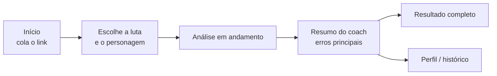

# 3. Protótipo (Mockup)

## Fluxo principal

### Telas



#### Tela 1 — Login



**Objetivo:** realizar o login do jogador.

* **Topo:** logo do LogCoach e botões "Analisar", "Planos" e "Entrar".
* **Centro:** opções "Entrar" e "Criar conta".
* **Abaixo do campo:** campos onde serão posicionados e-mail e senha, botão entrar.

**Princípios de usabilidade aplicados**

* **H4 · Consistência e padrões:** segue o padrão de login que o usuário já conhece. Entrar e criar conta ficam no mesmo cartão, alternados por abas.
* **H8 · Design estético e minimalista:** só o essencial, e-mail e senha.



#### Tela 2 — Início



**Objetivo:** levar o jogador da chegada até a análise com o menor número de passos.

* **Topo:** logo do LogCoach e botões "Analisar", "Planos" e "Entrar".
* **Centro:** frase de valor ("Descubra os erros que mais custam seu dano") e campo para colar o link do log do Warcraft Logs.
* **Abaixo do campo:** instruções de como funciona o processo, contendo as abas "1 - Cole o link", "2 - Escolha a luta" e "3- Leia o coach".
* **Rodapé:** chefes e especialização suportados, para o jogador saber, antes de colar o link, se o log dele pode ser analisado.

**Princípios de usabilidade aplicados**

* **H2 · Correspondência com o mundo real:** a proposta é explicada em português, na linguagem do jogador.
* **H5 · Prevenção de erros:** o formato do link aparece no campo, e o que é suportado aparece antes do envio.
* **H7 · Flexibilidade e eficiência:** o log de exemplo permite experimentar sem ter um log em mãos.
* **H10 · Ajuda e documentação:** o "Como funciona" resume o uso em três passos.



#### Tela 3 — Função principal: escolher a luta



**Objetivo:** definir exatamente qual luta e qual personagem serão analisados.

* Mostra o nome do relatório e a lista de lutas do log, cada uma com chefe, dificuldade, resultado (kill ou wipe) e duração.
* Lutas fora do recorte do MVP aparecem em cinza, com o motivo (por exemplo, "chefe ainda não suportado").
* Depois de escolher a luta, aparece a lista de Magos Arcanos presentes naquele log.
* Botão "Analisar".

**Princípios de usabilidade aplicados**

* **H5 · Prevenção de erros:** lutas que não podem ser analisadas ficam desabilitadas.
* **H9 · Reconhecer, diagnosticar e recuperar erros:** cada bloqueio explica o motivo e, quando possível, o que fazer ("escolha uma tentativa mais longa"). O aviso de conexão também explica o que está acontecendo.
* **H6 · Reconhecer em vez de lembrar:** a luta é identificada por chefe, número, duração e resultado, sem o jogador precisar lembrar dados do log.
* **H3 · Controle e liberdade do usuário:** dá para trocar o link a qualquer momento.



#### Tela 4 — Tela de carregamento



**Objetivo:** mostrar as etapas a serem efetuadas, carregando uma por uma.

* **Centro:** cartão "Analisando sua luta", com a luta, a dificuldade e o personagem (Nek'zali, a Enrosca-almas · Mítico · Harmonist).
* **Etapas, marcadas conforme concluem:** Buscando sua luta → Comparando com os melhores → Coach analisando.
* **Abaixo das etapas:** "Leva menos de 2 minutos. Você pode deixar esta aba aberta."

**Princípios de usabilidade aplicados**

* **H1 · Visibilidade do status:** o jogador vê em que etapa a análise está e quanto tempo ela leva.
* **H2 · Correspondência com o mundo real:** as etapas são descritas em linguagem simples, não em termos técnicos.



#### Tela 5 — Ação da IA: análise e resumo do coach



**Objetivo:**  entrega o diagnóstico priorizado.

* **Título:** o chefe ("Nek'zali, a Enrosca-almas").
* **À direita:** botão "← Escolher outra luta".
* **Quatro indicadores:**
  * Seu DPS&#x20;
  * Média do Top 10 do bracket 326–328&#x20;
  * Diferença&#x20;
  * Tempo ativo&#x20;
* **Bloco expansível "Com quem você foi comparado":** Top 10 do bracket 326–328 · 10 jogadores.
* **Abas:** "Resumo", "Linha do tempo" e "Todas as regras".
* **Resumo do coach:** parágrafo em linguagem natural que informa a diferença para a média dos melhores e aponta as maiores perdas.&#x20;
* **Erros do maior para o menor impacto:** cartões numerados. Cada um traz o título do erro, um selo de situação e quanto custou.&#x20;
* **Campo "Pergunte ao coach sobre este erro":** permite tirar dúvidas sobre um erro específico.

**Princípios de usabilidade aplicados**

* **H8 · Design estético e minimalista:** primeiro os números-chave e os erros de maior impacto. O detalhe fica nas outras abas.
* **H2 · Correspondência com o mundo real:** o diagnóstico vem escrito como um coach falaria, em português.
* **H3 · Controle e liberdade do usuário:** dá para voltar e escolher outra luta.



#### Tela 6 — Linha do tempo



**Objetivo:** entrega os detalhes em forma de gráfico.

* **Título:** o chefe ("Nek'zali, a Enrosca-almas").
* **À direita:** botão "← Escolher outra luta".
* **Quatro indicadores:**
  * Seu DPS
  * Média do Top 10 do bracket 326–328
  * Diferença
  * Tempo ativo
* **Bloco expansível "Com quem você foi comparado":** Top 10 do bracket 326–328 · 10 jogadores.
* **Abas:** "Resumo", "Linha do tempo" e "Todas as regras".
* **Linha do tempo:** barras dos cooldowns do jogador acima das barras da média dos melhores, no mesmo eixo de tempo. Assim dá para ver, no mesmo momento da luta, onde o uso do jogador se afasta do uso dos melhores.

**Princípios de usabilidade aplicados**

* **H6 · Reconhecer em vez de lembrar:** jogador e melhores aparecem lado a lado, no mesmo eixo, sem precisar comparar números de memória.
* **H4 · Consistência e padrões:** as C



#### Tela 7 — Todas as regras



**Objetivo:** tabela das regras.

* **Título:** o chefe ("Nek'zali, a Enrosca-almas").
* **À direita:** botão "← Escolher outra luta".
* **Quatro indicadores:**
  * Seu DPS
  * Média do Top 10 do bracket 326–328
  * Diferença
  * Tempo ativo
* **Bloco expansível "Com quem você foi comparado":** Top 10 do bracket 326–328 · 10 jogadores.
* **Abas:** "Resumo", "Linha do tempo" e "Todas as regras".
* **Todas as regras:** tabela com a regra, o valor do jogador, o valor dos melhores e o status (ok / atenção / erro).

**Princípios de usabilidade aplicados**

* **H4 · Consistência e padrões:** os mesmos três selos de situação em todas as regras.
* **H10 · Ajuda e documentação:** cada regra explica o próprio critério.
* **H7 · Flexibilidade e eficiência:** quem quer aprofundar tem a tabela completa, e quem quer rapidez fica no Resumo.



#### Tela 8 — Perfil / Configurações



**Objetivo:** reunir os dados da conta, o plano e a evolução do jogador.

* Personagem salvo (nome e servidor).
* Plano atual e quantidade de análises restantes no mês.
* Histórico de análises, com gráfico de evolução por chefe.
* Botões "Alterar senha" e "Excluir conta".

**Princípios de usabilidade aplicados**

* **H1 · Visibilidade do status:** o jogador vê quantas análises usou e quando o limite volta.
* **H3 · Controle e liberdade do usuário:** o jogador altera a senha e pode excluir a conta.
* **H5 · Prevenção de erros:** a exclusão fica em área vermelha e avisa que não dá para desfazer.
* **H10 · Ajuda e documentação:** quando a evolução ainda não pode ser exibida, a tela explica o que fazer.
* **H7 · Flexibilidade e eficiência:** "Nova análise" fica a um clique, direto do perfil.



#### Tela 9 — Planos



Dois cartões, lado a lado:

**Grátis**

* 5 análises por mês
* Histórico de análises

**Pro**

* Análises ilimitadas
* Pergunta ao coach
* Comparação entre análises


**Sem pagamento real no MVP.** Os planos são demonstrados, mas a cobrança fica para o pós-MVP.


**Princípios de usabilidade aplicados**

* **H1 · Visibilidade do status:** o plano atual vem identificado.
* **H8 · Design estético e minimalista:** dois cartões, lado a lado, fáceis de comparar.
* **H5 · Prevenção de erros:** o Pro aparece claramente como indisponível, então o usuário não tenta contratar o que ainda não existe.



Princípios de usabilidade na versão alfa (visão consolidada)

* **H1 · Visibilidade do status:** Telas 4, 8 e 9
* **H2 · Correspondência com o mundo real:** Telas 2, 4 e 5
* **H3 · Controle e liberdade do usuário:** Telas 3, 5 e 8
* **H4 · Consistência e padrões:** elementos comuns e Telas 1, 6 e 7
* **H5 · Prevenção de erros:** Telas 2, 3, 8 e 9
* **H6 · Reconhecer em vez de lembrar:** Telas 3 e 6
* **H7 · Flexibilidade e eficiência:** Telas 2, 7 e 8
* **H8 · Design estético e minimalista:** Telas 1, 5 e 9
* **H9 · Reconhecer, diagnosticar e recuperar erros:** Tela 3
* **H10 · Ajuda e documentação:** Telas 2, 7 e 8

