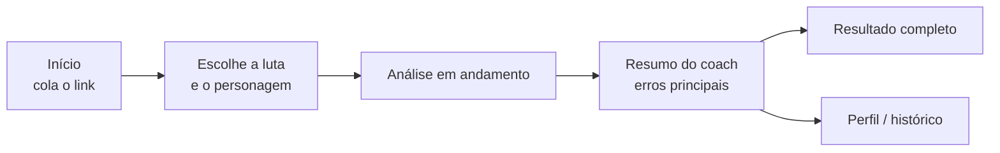

# 3. Protótipo (Mockup)

Wireframes das telas principais. Os mockups em alta fidelidade (Figma) entram aqui na RT03.

> **Link do Figma:** _a adicionar_

## Fluxo principal

## Tela 1 — Início / Login
- Topo: logo LogCoach e botão "Entrar".
- Centro: frase de valor ("Descubra os erros que mais custam seu dano") e campo para colar o link do log.
- Abaixo: "Analisar sem conta" e "Criar conta grátis".
- Rodapé: chefes e especialização suportados.

## Tela 2 — Função principal: escolher a luta
- Mostra o nome do relatório e a lista de lutas (chefe, dificuldade, kill ou wipe, duração).
- Lutas fora do recorte aparecem cinza, com o motivo ("chefe ainda não suportado").
- Depois de escolher a luta, aparece a lista de Magos Arcanos daquele log.
- Botão "Analisar".

## Tela 3 — Ação da IA: análise e resumo do coach
- Barra de progresso em etapas: "Buscando sua luta → Comparando com os melhores → Coach analisando".
- Ao terminar: card do coach com os erros principais, do maior para o menor impacto, cada um com título curto, quanto custou (em % de dano) e o que fazer.
- Campo "Pergunte ao coach sobre este erro".

## Tela 4 — Perfil / Configurações
- Personagem salvo (nome, servidor).
- Plano atual e análises restantes no mês.
- Histórico de análises com gráfico de evolução por chefe.
- Botões "Alterar senha" e "Excluir conta".

## Tela 5 — Resultado completo
- Abas: "Resumo", "Linha do tempo" e "Todas as regras".
- Linha do tempo: barras dos cooldowns do jogador acima das barras da média dos melhores, no mesmo eixo de tempo.
- Todas as regras: tabela com regra, valor do jogador, valor dos melhores e status (ok / atenção / erro).

## Tela extra — Planos
- Dois cartões: Grátis (5 análises/mês, histórico) e Pro (ilimitado, pergunta ao coach, comparação entre análises).
- Sem pagamento real no MVP.
