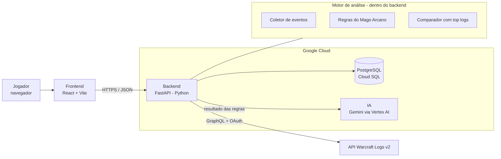

# 5. Diagrama de Arquitetura

> Se o diagrama não renderizar no GitBook, ative a integração **Mermaid** no espaço ou exporte uma imagem pelo [mermaid.live](https://mermaid.live).

## Como uma análise funciona

1. O jogador cola o link. O frontend valida o formato e envia ao backend.
2. O backend busca a luta na API do Warcraft Logs e os melhores logs (do cache ou da API).
3. O motor de análise aplica as regras e calcula a diferença para os melhores.
4. Só esse resumo vai para a IA, que devolve a explicação em português.
5. O resultado é salvo no banco e mostrado ao jogador.

**Por que a IA não recebe o log bruto:** o log tem milhares de eventos. Mandar tudo seria caro e aumentaria o risco de a IA inventar coisas. O código calcula os números e a IA só explica.

## Componentes

| Componente | Tecnologia | Responsabilidade |
|---|---|---|
| Frontend | React + Vite | Telas, validação de entrada, exibição do relatório |
| Backend | FastAPI (Python) | Rotas, autenticação, orquestração da análise |
| Motor de análise | Python (módulo do backend) | Coleta de eventos, regras do Mago Arcano, comparação |
| Banco | PostgreSQL (Cloud SQL) / SQLite em dev | Usuários, análises, cache dos top logs |
| IA | Gemini via Vertex AI | Explicar e priorizar os erros em português |
| Fonte de dados | API Warcraft Logs v2 (GraphQL) | Eventos da luta e rankings |

## Ambientes

- **Desenvolvimento:** SQLite local e dados de exemplo salvos em arquivo.
- **Apresentação:** backend no Cloud Run e banco no Cloud SQL, com um log de exemplo já processado como reserva caso a internet falhe.
