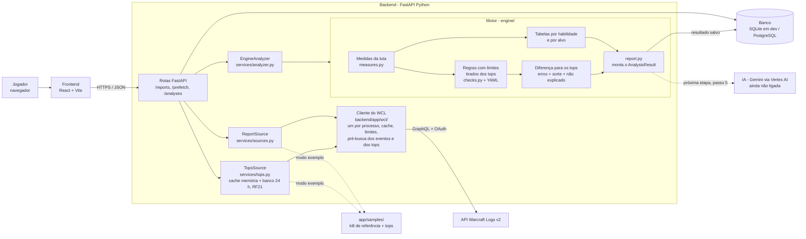

# 5. Diagrama de Arquitetura

> Se o diagrama não renderizar no GitBook, ative a integração **Mermaid** no espaço ou exporte uma imagem pelo [mermaid.live](https://mermaid.live).
>
> As linhas tracejadas são o modo exemplo (sem internet) e a IA, que ainda não está ligada (passo 5).

## Como uma análise funciona

1. O jogador cola o link. O frontend valida o formato e o backend busca só a lista de lutas no Warcraft Logs (`/reports/resolve`).
2. Ao escolher a luta, o backend traz os Magos Arcanos dela. Quando o personagem fica definido, a **pré-busca** (`/prefetch`) baixa em segundo plano os eventos da luta e, se ainda não estiverem guardados, os **top 10 do mesmo bracket de item level**. O cliente do WCL é um só por processo, guarda cache e respeita limites de pontos e pausas depois de falha (item 12.8).
3. A fonte dos tops (`services/tops.py`) guarda os tops na memória e no banco por 24 h. Se o log analisado está no top 10, ele sai e entra o 11º (RF21; item 12.13).
4. O `EngineAnalyzer` (`services/analyzer.py`) entrega a luta do jogador e as dos tops ao motor (`engine/`), que mede a luta por fase, aplica as regras do Mago Arcano e do chefe (YAML) com os limites tirados dos próprios tops e monta as tabelas por habilidade e por alvo (RF22).
5. O motor explica a diferença para os tops em % do dano do jogador: **erros + sorte + não explicado** (RF23). O `report.py` monta o `AnalysisResult` (item 12.9).
6. O resultado é salvo no banco e mostrado ao jogador.
7. **Próxima etapa (passo 5):** só os fatos, as tabelas e os guias vão para a IA (Gemini), que ordena e explica em português. Se a IA falhar, o relatório sai só com as regras (RF17). Hoje o relatório já sai só com as regras.

**Por que a IA não recebe o log bruto:** o log tem milhares de eventos. Mandar tudo seria caro e aumentaria o risco de a IA inventar coisas. O código calcula os números e a IA só explica.

## Componentes

| Componente       | Tecnologia                             | Responsabilidade                                                                                       |
| ---------------- | -------------------------------------- | ------------------------------------------------------------------------------------------------------ |
| Frontend         | React + Vite                           | Telas, validação de entrada, exibição do relatório                                                     |
| Backend          | FastAPI (Python)                       | Rotas, autenticação, orquestração da análise                                                           |
| Motor de análise | Python (`backend/app/engine/`)         | Medidas por fase, regras com limites tirados dos tops, diferença para os tops, tabelas por habilidade e por alvo (ver item 12) |
| Banco            | PostgreSQL (Cloud SQL) / SQLite em dev | Usuários, análises, cópia dos tops por 24 h                                                            |
| IA               | Gemini via Vertex AI (passo 5, ainda não ligada) | Explicar e priorizar os erros em português                                                   |
| Fonte de dados   | API Warcraft Logs v2 (GraphQL), cliente em `backend/app/wcl/` | Lutas, eventos da luta e rankings; no modo exemplo, arquivos de `app/samples/` |

## Ambientes

* **Desenvolvimento:** SQLite local (`backend/logcoach.db`). Com `DATA_SOURCE=exemplo`, relatório, eventos e tops vêm dos arquivos de `app/samples/` (kill de referência do Harmonist e top 10 do bracket), sem internet; é também o que o CI usa. Com `DATA_SOURCE=wcl`, a API real.
* **Apresentação:** backend no Cloud Run e banco no Cloud SQL, com um log de exemplo já processado como reserva caso a internet falhe.
