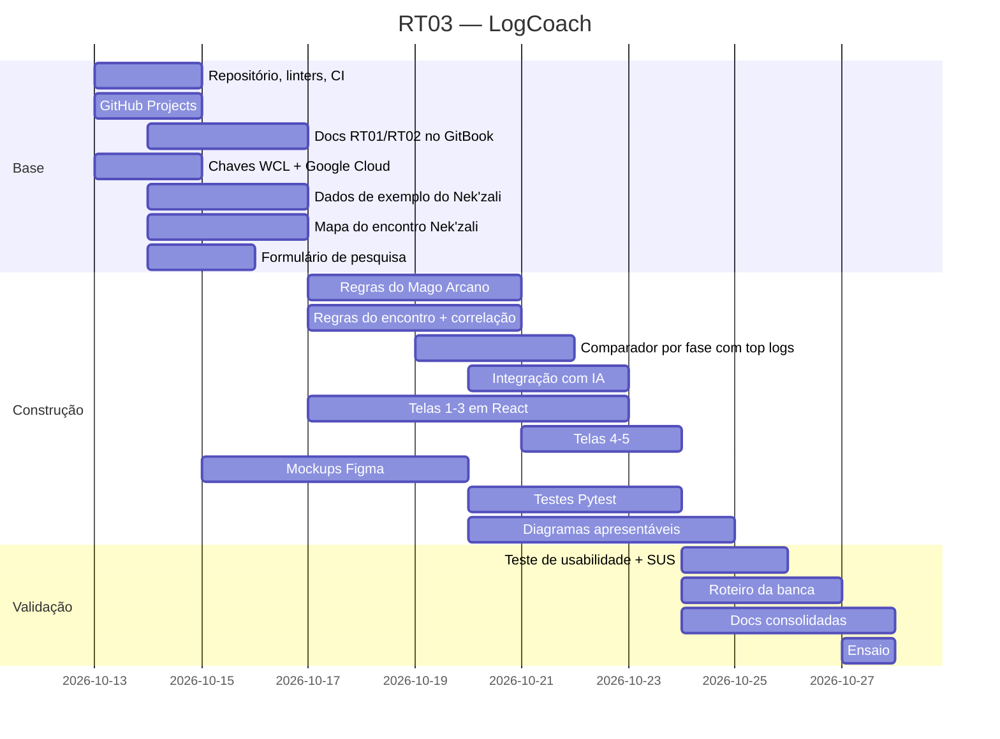

# 6. Planejamento de Tarefas (Cronograma)

**Planilha de entregas:** controle de prazos mantido pelo Luiz.



**Quadro oficial:** GitHub Projects do repositório (_link a adicionar_), com colunas *Backlog → A fazer → Fazendo → Revisão → Feito*.

**Tarefas:** cada frente de trabalho é uma issue no GitHub, de #3 a #17, com responsável, situação e dependências: [issues com o rótulo `frente`](https://github.com/jp4inbr/LogCoach/issues?q=label%3Afrente). As concluídas ficam fechadas. O rótulo `RT03` marca o que é da entrega de 28/10 e `banca`, o que fica para o fim de novembro.

**Meta da RT03 (28/10/2026):** versão alfa rodando com o 1º chefe (Nek'zali), documentação consolidada, relatório de IA, testes e roteiro da banca.

## 6.1 Papéis

> Cada linha é uma frente de trabalho. As frentes "a definir" estão abertas: os integrantes se inscrevem de acordo com o que conseguem entregar.

| Pessoa | Papel | Entregas |
|---|---|---|
| **Arthur** | Líder técnico + especialista do jogo | Motor de análise, regras do Mago Arcano e do encontro (mapa do Nek'zali), integração com Warcraft Logs e IA, validação de todo conteúdo de WoW |
| **Pedro** | Frontend, backend de contas e qualidade | Base técnica (linters, CI), telas em React ligadas ao backend, contas, histórico e limite do plano; evidências de usabilidade (8.1) e métricas (11) |
| **João** | GitBook | Organização e revisão das páginas no GitBook |
| **Luiz** | Gestão | Planilha de entregas, quadro no GitHub Projects, checagem de prazos |
| **Danilo** | Design | Mockups das telas no Figma (item 3) |
| **Matheus Damasceno** | Planejamento estratégico | Product Vision Board (item 2.B) |
| **Matheus Morgado** | Qualidade da Apresentação | Elaborar os slides e garantir que o material estará disponível e correto na hora da apresentação à banca |
| **Arthur** | Relatório de IA | Item 9, a partir dos prompts, interações e relatórios dos membros do grupo |
| **Arthur** | Casos de teste | Cenários de erro e validação em linguagem simples (base dos testes Pytest) e item 10 |
| _a definir_ | Teste de usabilidade | Aplicar o roteiro e o questionário SUS (8.3) e registrar os resultados |
| _a definir_ | Pesquisa | Formulário com jogadores brasileiros (evidências do problema) |
| _a definir_ | Aplicação da Usabilidade | Acompanhar como os princípios de usabilidade entram na aplicação, junto ao front/backend, e manter o item 8 |
| _a definir_ | Diagramas | Converter os fluxogramas em Mermaid (arquitetura, fluxo de telas, motor de análise, cronograma) em diagramas apresentáveis para o GitBook e os slides |

## 6.2 Cronograma

| Fase | Período | Principais tarefas |
|---|---|---|
| Base | 13/10 – 16/10 | Repositório e CI, quadro, docs no GitBook, chaves de API, dados de exemplo, mapa do encontro Nek'zali, formulário, mockups 1–2 |
| Construção | 17/10 – 23/10 | Regras da spec e do encontro, correlação, comparador por fase, IA, telas React, mockups 3–5, testes, diagramas apresentáveis, rascunho do relatório de IA |
| Validação | 24/10 – 27/10 | Teste de usabilidade, roteiro da banca, documentação consolidada, ensaio |
| Entrega | 28/10 | RT03 |

## 6.3 Tarefas abertas depois da RT03 (para o cronograma)

Levantadas no review técnico de 26–28/10. O detalhe (onde mexer e por quê) está no `CLAUDE.md`, "Próximos passos". Situação em 04/11/2026.

| Tarefa | Por quê | Situação | Dono |
|---|---|---|---|
| Buffs externos no motor (Power Infusion, Bloodlust etc.) | Um top com PI a cada Surge tem vantagem; o motor precisa mostrar isso como contexto | **Feito** em 03/11 (`cf65190`, PR #27): entram como contexto da análise | Arthur |
| Motor de análise (regras, tabela por habilidade e por alvo, diferença para os tops) | Antes só o exemplo escrito à mão do Harmonist tinha resultado | **Feito**: PR #27, mergeada em 04/11 (`77aecc0`) | Arthur |
| Cache e cliente único do Warcraft Logs | Cada busca pedia token e baixava o relatório de novo (limite de 1000 pontos/h) | **Feito** em 28/10 (`4d1493c`, PR #25) | Arthur |
| Jogador pelo id do ator do Warcraft Logs | Havia duas regras de nome + reino | **Feito** em 28/10 (`ed73177`, PR #25) | Arthur |
| Código de erro próprio para "Warcraft Logs fora do ar" | Aparecia como "relatório privado" | **Feito** em 28/10: `wcl_unavailable` (503), com mensagem por causa (`4d1493c`, `4842aee`) | Arthur |
| Testes T03–T05 e T11–T14 | Dependiam do motor | **Feito**: passam com o motor (`test_engine_base.py`, `test_engine_rules.py`) | Arthur |
| Pacote da IA (Gemini) + resposta reserva | RF17, RF24 (passo 5 do `CLAUDE.md`); inclui o teste T07 (falha da IA) | Aberto. Hoje o relatório sai só com as regras (RF17) | |
| Conferir no Wowhead todos os nomes em pt-BR (magias, buffs, talentos) | Há nomes divergentes entre guia, exemplo e cliente (ex.: Clearcasting = "Abstração" no Warcraft Logs em português) | Aberto | |
| Deploy no Cloud Run | Publicação para a banca (item 13): CPU sempre alocada, uma instância na alfa, IP real atrás do proxy | Aberto (backlog) | |
| Teste de usabilidade + SUS | Roteiro e questionário prontos (item 8.3); falta aplicar com 5 pessoas | Aberto | |

## 6.4 Riscos e plano B

| Risco | Plano B |
| --- | --- |
| Arthur é o único que domina o jogo e o motor | Regras documentadas em linguagem simples (item 12) e código revisado por pelo menos mais um integrante |
| Integração com IA atrasa | Relatório só com as regras (RF17), que é o estado atual: o resultado mostra erros, regras, tabelas e a diferença para os tops; o resumo do coach entra quando a IA estiver ligada |
| Internet falha na apresentação | Rodar local com `DATA_SOURCE=exemplo`: o motor real roda sobre as cópias guardadas do kill de referência e dos 10 tops (`backend/app/samples/`) |
| Warcraft Logs fora do ar | O sistema usa sozinho a cópia guardada dos tops (do banco ou de `app/samples/tops/`) e avisa que ela pode estar desatualizada; a lista de lutas já buscada aparece com aviso |
| Não dá tempo dos 3 chefes | Alfa entrega só Nek'zali; os outros serão validados perante o tempo hábil |
| Membros sem entregar | Luiz cobra no quadro; tarefas sem dono até 16/10 são redistribuídas |

## 6.5 O que foi feito entre a RT03 e a banca

Resumo do histórico do repositório (`git log`) de 28/10 a 04/11/2026.

| Data | Entrega | Quem |
|---|---|---|
| 28/10 | Evidências de usabilidade (8.1), roteiro do teste e questionário SUS, uso de IA (9.2 e 9.3) e métricas (11) — PR #18 | Pedro Nogueira |
| 28/10 | Revisão das páginas no GitBook (PR #19), integrada sem dados pessoais na PR #21 | João Nicacio (PR #19) e Arthur Beiral (PR #21) |
| 28/10 | Pendências antigas da PR #2 fechadas (PR #20): exemplo refeito a partir do log real, buffs externos na busca, primeiras peças do motor (Prismatic Bolt, Arcane Soul e janela do Surge) | Arthur Beiral |
| 28/10 | Warcraft Logs robusto: cliente único com cache, jogador pelo id do ator, erro `wcl_unavailable` por causa, lista leve de lutas e Magos por luta, botão "Atualizar lutas", atualização automática do log ao vivo, pré-busca dos eventos ao clicar no personagem, pausa depois de falha | Arthur Beiral |
| 28/10 | README do repositório e `.editorconfig`; ajuste do SQLite e das dependências do frontend, desfeito no mesmo dia por quebrar o CI (PR #23) | Yohanan Amaral e Pedro Nogueira |
| 29/10 | URL do SQLite legível no Windows e CI também no Windows (PR #24) | Arthur Beiral |
| 02/11 | Integração com o Warcraft Logs mergeada (PR #25) e simplificações da revisão da área (PR #26); cuidados do deploy no Cloud Run levantados | Arthur Beiral |
| 03/11 | Motor, etapas 1 e 2: fases, referência dos tops, tabelas por habilidade e por alvo; regras do Arcano, impacto em % e diferença para os tops; validação com o WCL (tempo ativo, mortes, estado do pull); defensivo pelos picos de dano | Arthur Beiral |
| 04/11 | Motor, etapa 3: busca dos tops do bracket com cache de 24 h no banco e RF21 pelo log exato; DPS oficial do Warcraft Logs; desconto do dano creditado ao Evocador Aumentação, também por buff | Arthur Beiral |
| 04/11 | Motor, etapa 4: `EngineAnalyzer` na rota de análises (sai o resultado escrito à mão) e tela com a diferença para os tops, a referência das regras e o dano por alvo — PR #27 mergeada | Arthur Beiral |
