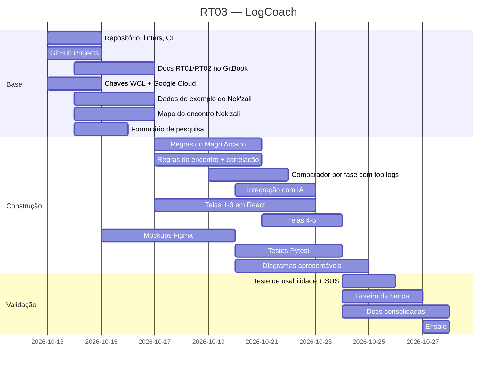

# 6. Planejamento de Tarefas (Cronograma)



## 6.1 Papéis

> Cada "Membro" abaixo é uma frente de trabalho. Os integrantes se inscrevem nas frentes de acordo com o que conseguem entregar.

<table data-search="false"><thead><tr><th>Pessoa</th><th>Papel</th><th>Entregas</th></tr></thead><tbody><tr><td><strong>Arthur</strong></td><td>Líder técnico + especialista do jogo</td><td>Motor de análise, regras do Mago Arcano e do encontro (mapa do Nek'zali), integração com Warcraft Logs e IA, validação de todo conteúdo de WoW</td></tr><tr><td><strong>Pedro</strong></td><td>Frontend + qualidade</td><td>Linters, CI, telas em React ligadas ao backend</td></tr><tr><td><strong>João</strong></td><td>GitBook</td><td>Organização e revisão das páginas no GitBook</td></tr><tr><td><strong>Luiz</strong></td><td>Gestão</td><td>Documentação das entregas no excell</td></tr><tr><td><strong>Danilo</strong></td><td>Design</td><td>Mockups das 5 telas </td></tr><tr><td><strong>Arthur</strong></td><td>Relatório de IA</td><td>Item 9, a partir dos prompts, interações e relatórios dos membros do grupo.</td></tr><tr><td><strong>Arthur</strong></td><td>Casos de teste</td><td>Entender o sistema e contexto para criar cenários de erro e validação em linguagem simples (base dos testes Pytest) e manter o item 10.</td></tr><tr><td><strong>Matheus Barreto</strong></td><td>Qualidade da Apresentação</td><td>Elaborar os slides e garantir que o material estará disponível e correto na hora da apresentação à banca.</td></tr><tr><td>Matheus Damasceno</td><td>Planejamento estratégico</td><td>Criação do quadro Product Vision Board</td></tr></tbody></table>

## 6.2 Cronograma

