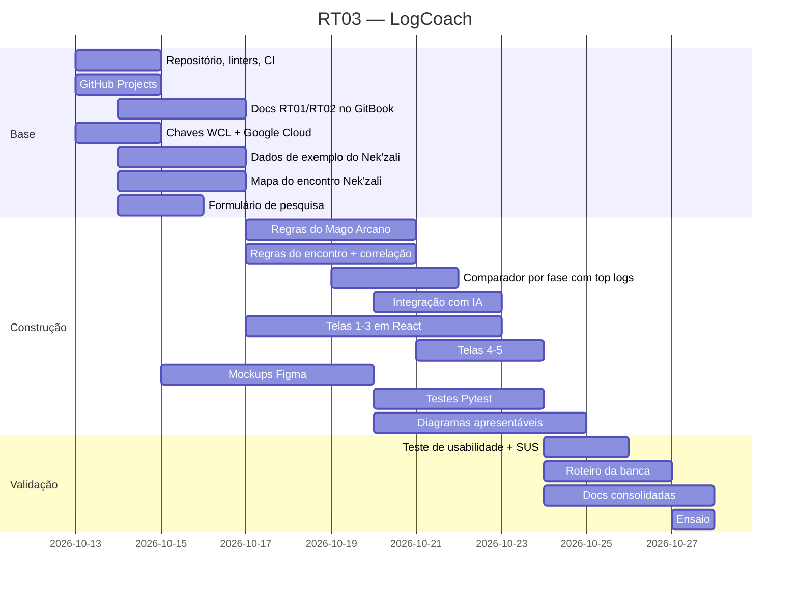

# 6. Planejamento de Tarefas (Cronograma)

**Quadro oficial:** GitHub Projects do repositório (_link a adicionar_), com colunas *Backlog → A fazer → Fazendo → Revisão → Feito*.

**Tarefas:** cada frente de trabalho é uma issue no GitHub, de #3 a #17, com responsável, situação e dependências: [issues com o rótulo `frente`](https://github.com/jp4inbr/LogCoach/issues?q=label%3Afrente). As concluídas ficam fechadas. O rótulo `RT03` marca o que é da entrega de 28/10 e `banca`, o que fica para o fim de novembro.

**Meta da RT03 (28/10/2026):** versão alfa rodando com o 1º chefe (Nek'zali), documentação consolidada, relatório de IA, testes e roteiro da banca.

## 6.1 Papéis

> Cada "Membro" abaixo é uma frente de trabalho. Os integrantes se inscrevem nas frentes de acordo com o que conseguem entregar.

| Pessoa        | Papel                                | Entregas                                                                                                                                 |
| ------------- | ------------------------------------ | ---------------------------------------------------------------------------------------------------------------------------------------- |
| **Arthur**    | Líder técnico + especialista do jogo | Motor de análise, regras do Mago Arcano e do encontro (mapa do Nek'zali), integração com Warcraft Logs e IA, validação de todo conteúdo de WoW |
| **Pedro**     | Frontend, backend de contas e qualidade | Base técnica (linters, CI), telas em React ligadas ao backend, contas, histórico e limite do plano; evidências de usabilidade (8.1) e métricas (11) |
| **João**      | GitBook                              | Organização e revisão das páginas no GitBook                                                                                             |
| **Luiz**      | Gestão                               | Quadro no GitHub Projects, checagem de prazos, roteiro dos slides                                                                        |
| **Membro 5**  | Design                               | Mockups das 5 telas + planos no Figma                                                                                                    |
| **Membro 6**  | Design + teste                       | Apoio no Figma; teste de usabilidade e nota SUS                                                                                          |
| **Membro 7**  | Pesquisa                             | Formulário com jogadores brasileiros (evidências do problema)                                                                            |
| **Membro 8**  | Relatório de IA                      | Item 9, a partir dos prompts, interações e relatórios dos membros do grupo.                                                              |
| **Membro 9**  | Casos de teste                       | Entender o sistema e contexto para criar cenários de erro e validação em linguagem simples (base dos testes Pytest) e manter o item 10. |
| **Membro 10** | Aplicação da Usabilidade             | Entender como os princípios da usabilidade será integrado pela aplicação, atuando junto ao front/backend, e manter o item 08.           |
| **Membro 11** | Qualidade da Apresentação            | Elaborar os slides e garantir que o material estará disponível e correto na hora da apresentação à banca.                                |
| **Membro 12** | Diagramas                            | Converter os fluxogramas em Mermaid (arquitetura, fluxo de telas, motor de análise, cronograma) em diagramas apresentáveis (Figma, draw.io ou Excalidraw) para o GitBook e os slides. |

## 6.2 Cronograma

| Fase | Período | Principais tarefas |
|---|---|---|
| Base | 13/10 – 16/10 | Repositório e CI, quadro, docs no GitBook, chaves de API, dados de exemplo, mapa do encontro Nek'zali, formulário, mockups 1–2 |
| Construção | 17/10 – 23/10 | Regras da spec e do encontro, correlação, comparador por fase, IA, telas React, mockups 3–5, testes, diagramas apresentáveis, rascunho do relatório de IA |
| Validação | 24/10 – 27/10 | Teste de usabilidade, roteiro da banca, documentação consolidada, ensaio |
| Entrega | 28/10 | RT03 |

## 6.3 Tarefas abertas depois da RT03 (para o cronograma)

Levantadas no review técnico de 26–28/10. O detalhe (onde mexer e por quê) está no `CLAUDE.md`, "Próximos passos". Falta definir dono e data no quadro.

| Tarefa | Por quê | Dono |
|---|---|---|
| Buffs externos no motor (Power Infusion, Bloodlust etc.) | A busca já traz os externos (corrigida em 28/10); falta o motor contar e mostrar como contexto, já que um top com PI a cada Surge tem vantagem | |
| Conferir no Wowhead todos os nomes em pt-BR (magias, buffs, talentos) | Há nomes divergentes entre guia, exemplo e cliente (ex.: Clearcasting = "Abstração" no Warcraft Logs em português) | |
| Motor de análise (regras, tabela por habilidade) | Hoje só o exemplo do Harmonist tem resultado | Arthur |
| Pacote da IA (Gemini) + resposta reserva | RF17, RF24 | |
| Cache e cliente único do Warcraft Logs | Cada busca pede token e baixa o relatório de novo (limite de 1000 pontos/h) | |
| Jogador pelo id do ator do Warcraft Logs | Hoje há duas regras de nome + reino | |
| Código de erro próprio para "Warcraft Logs fora do ar" | Hoje aparece como "relatório privado" | |
| Testes T03–T05, T07, T11–T14 | Dependem do motor e da IA | |

## 6.4 Riscos e plano B

| Risco                                        | Plano B                                                                   |
| -------------------------------------------- | ------------------------------------------------------------------------- |
| Arthur é o único que domina o jogo e o motor | Regras documentadas em linguagem simples (item 12) e código revisado por pelo menos mais um integrante |
| Integração com IA atrasa                     | Demo usa resposta reserva salva, informando isso ao professor             |
| Internet falha na apresentação               | Log de exemplo já processado e salvo                                      |
| Não dá tempo dos 3 chefes                    | Alfa entrega só Nek'zali; os outros serão validados perante o tempo hábil |
| Membros sem entregar                         | Luiz cobra no quadro; tarefas sem dono até 16/10 são redistribuídas       |
