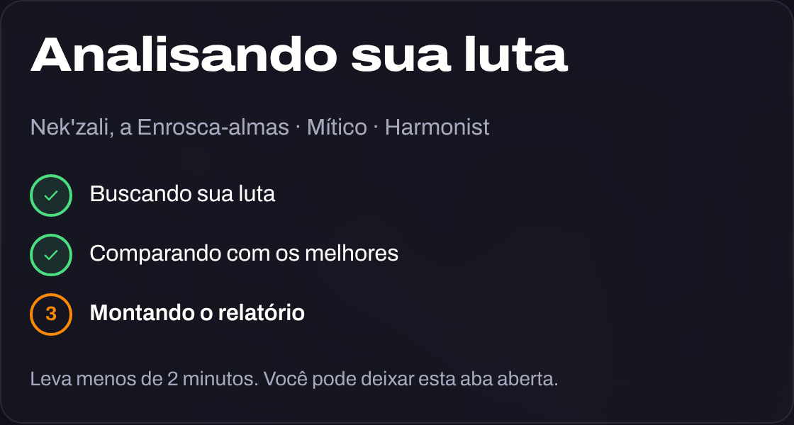
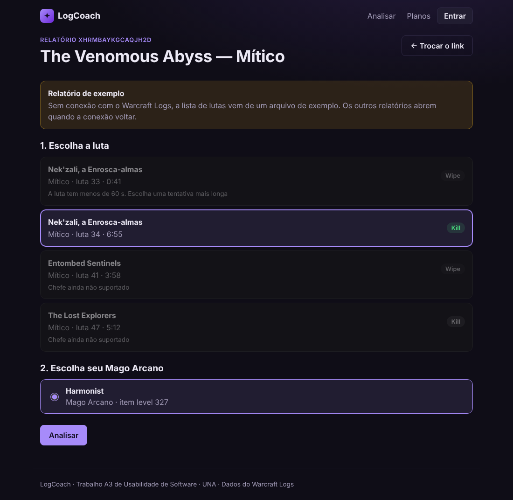
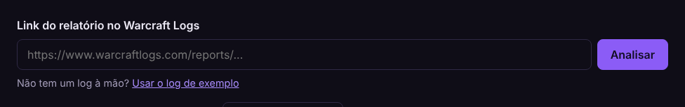
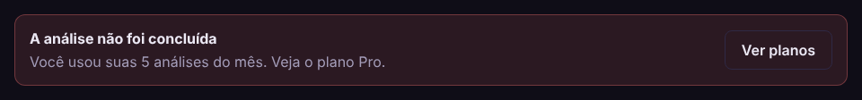
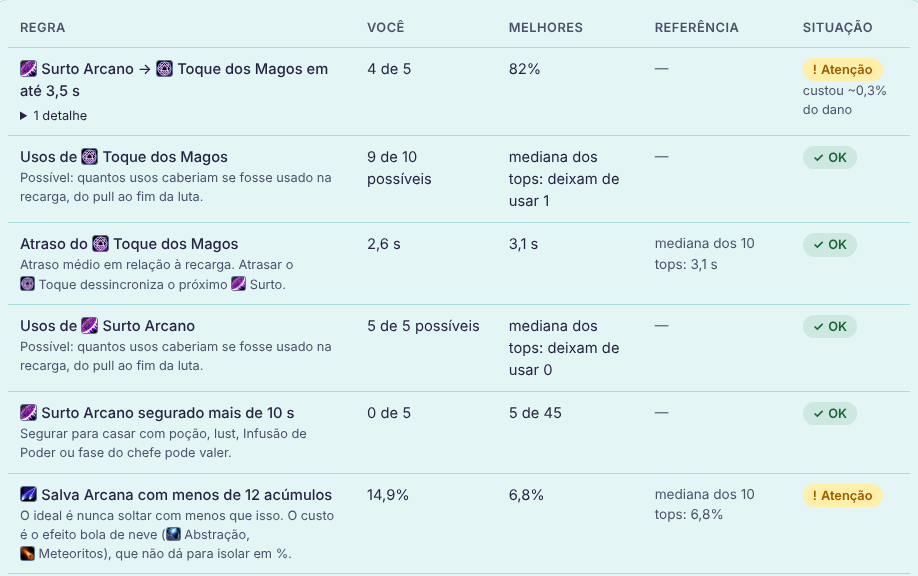
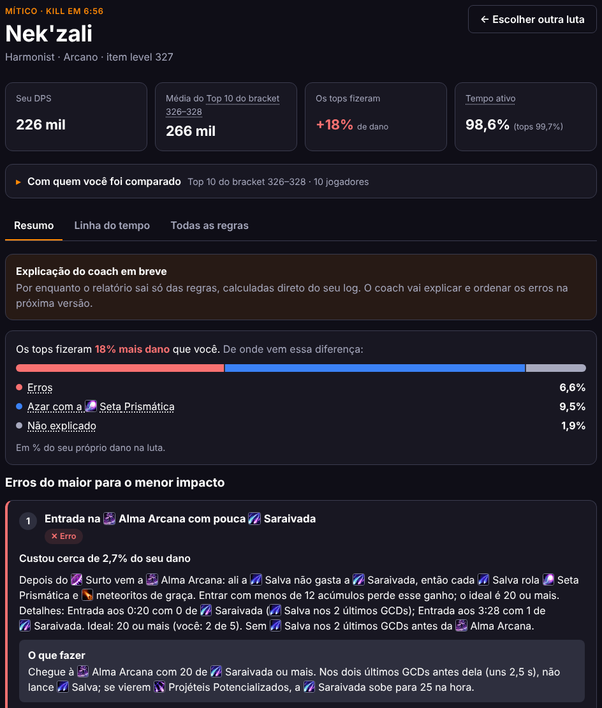

# 8. Relatório de Princípios de Usabilidade Aplicados

## 8.1 Heurísticas de Nielsen aplicadas

As evidências são prints da alfa rodando, com o relatório de exemplo do Nek'zali Mítico. As Figuras 1 a 8 são da versão de 27/10/2026. As Figuras 9 a 11 são da tela de resultado com o motor de análise, o tema claro e escuro e os ícones das magias (`main` de 15/11/2026, PRs #27, #29 e #30), com os números calculados a partir do log.

<table data-search="false"><thead><tr><th>Heurística</th><th>Onde aparece no LogCoach</th><th>Evidência (print)</th><th>Tela no protótipo (item 3)</th></tr></thead><tbody><tr><td>Visibilidade do status do sistema</td><td>Barra de progresso em etapas durante a análise: "Buscando sua luta → Comparando com os melhores → Montando o relatório"; no perfil, uso do plano no mês</td><td><a href="08-principios-de-usabilidade.md#figura-1-andamento-em-etapas">Figura 1</a></td><td>4, 8 e 9</td></tr><tr><td>Correspondência com o mundo real</td><td>Interface em português, com os nomes do cliente do jogo em pt-BR ("Nek'zali, a Enrosca-almas", "Mítico", "Kill", "Wipe"); relatório em linguagem simples</td><td><a href="08-principios-de-usabilidade.md#figura-2-escolher-a-luta">Figura 2</a></td><td>2, 4 e 5</td></tr><tr><td>Controle e liberdade do usuário</td><td>Botões "← Trocar o link" e "← Escolher outra luta"; o voltar do navegador funciona em todas as telas; no perfil, alterar a senha e excluir a conta; botão ☀/☾ no cabeçalho para trocar o tema, que segue o sistema até a pessoa escolher (<a href="15-padrao-de-cores.md">item 15</a>)</td><td><a href="08-principios-de-usabilidade.md#figura-3-voltar-sem-perder-o-caminho">Figura 3</a></td><td>3, 5 e 8</td></tr><tr><td>Consistência e padrões</td><td>Mesmas cores e ícones para ok / atenção / erro nos erros, nas regras, nos avisos e na linha do tempo; login no padrão e-mail e senha; tema claro e escuro com as mesmas cores de situação nos dois (<a href="15-padrao-de-cores.md">item 15</a>)</td><td><a href="08-principios-de-usabilidade.md#figura-9-mesmas-cores-nos-dois-temas">Figura 9</a></td><td>1, 6 e 7</td></tr><tr><td>Prevenção de erros</td><td>Link conferido antes de enviar; lutas que não podem ser analisadas aparecem em cinza, com o motivo; exclusão da conta em área vermelha, com confirmação e aviso de que não dá para desfazer; plano Pro marcado como "Em breve"</td><td><a href="08-principios-de-usabilidade.md#figura-4-link-conferido-antes-de-enviar">Figura 4</a> e <a href="08-principios-de-usabilidade.md#figura-2-escolher-a-luta">Figura 2</a></td><td>2, 3, 8 e 9</td></tr><tr><td>Reconhecer em vez de lembrar</td><td>Cada luta identificada por chefe, número, duração e resultado; o personagem da última análise (ou o único da luta) já vem marcado; jogador e melhores lado a lado no mesmo eixo; os erros principais ficam no topo do resultado</td><td><a href="08-principios-de-usabilidade.md#figura-5-personagem-marcado-sozinho">Figura 5</a></td><td>3 e 6</td></tr><tr><td>Flexibilidade e eficiência</td><td>Atalho "Usar o log de exemplo" para quem não tem um log à mão; usuário frequente pula a escolha do personagem; "Nova análise" a um clique, direto do perfil</td><td><a href="08-principios-de-usabilidade.md#figura-6-atalho-do-log-de-exemplo">Figura 6</a> e <a href="08-principios-de-usabilidade.md#figura-5-personagem-marcado-sozinho">Figura 5</a></td><td>2, 7 e 8</td></tr><tr><td>Design estético e minimalista</td><td>Resumo só com os erros de maior impacto; detalhes nas abas "Linha do tempo" e "Todas as regras"; login só com e-mail e senha; planos em dois cartões lado a lado</td><td><a href="08-principios-de-usabilidade.md#figura-10-resumo-primeiro-detalhes-nas-abas">Figura 10</a></td><td>1, 5 e 9</td></tr><tr><td>Ajudar a reconhecer e corrigir erros</td><td>Mensagens no próprio campo dizendo o que fazer; cada luta bloqueada explica o motivo; limite do plano com o caminho para resolver</td><td><a href="08-principios-de-usabilidade.md#figura-7-erros-mostrados-no-campo">Figura 7</a> e <a href="08-principios-de-usabilidade.md#figura-8-limite-do-plano">Figura 8</a></td><td>3</td></tr><tr><td>Ajuda e documentação</td><td>Termos técnicos ("bracket", "tempo ativo", tabela por habilidade) com linha pontilhada e explicação ao passar o mouse ou tocar; "Como funciona" em três passos no início; quando ainda não há evolução para mostrar, o perfil diz o que fazer</td><td><a href="08-principios-de-usabilidade.md#figura-11-dica-do-termo-bracket">Figura 11</a></td><td>2, 7 e 8</td></tr></tbody></table>

### Figura 1: andamento em etapas

### Figura 2: escolher a luta

Nomes em português e lutas fora do recorte em cinza, cada uma com o motivo ("A luta tem menos de 60 s", "Chefe ainda não suportado").

### Figura 3: voltar sem perder o caminho

### Figura 4: link conferido antes de enviar

### Figura 5: personagem marcado sozinho

### Figura 6: atalho do log de exemplo

### Figura 7: erros mostrados no campo

### Figura 8: limite do plano

### Figura 9: mesmas cores nos dois temas

Na aba "Todas as regras", cada regra tem o mesmo selo de situação (✓ OK, ! Atenção, × Erro), com ícone e texto além da cor. Os selos repetem as cores dos erros, dos avisos e da linha do tempo, e são iguais no tema escuro e no claro.

### Figura 10: resumo primeiro, detalhes nas abas

O resumo mostra só quatro números, de onde vem a diferença para os tops (erros, azar e não explicado) e os erros do maior para o menor impacto, cada um com quanto custou e o que fazer. Linha do tempo e regras ficam nas outras abas.

### Figura 11: dica do termo bracket

## 8.2 Validação de entradas e tratamento de erros

| Situação                         | Mensagem ao usuário                                                                         |
| -------------------------------- | ------------------------------------------------------------------------------------------- |
| Link não é do Warcraft Logs      | "Esse link não parece ser do Warcraft Logs. Ele deve começar com warcraftlogs.com/reports/" |
| Relatório privado ou inexistente | "Não conseguimos abrir esse relatório. Confira se ele está público no Warcraft Logs"        |
| Luta de chefe não suportado      | Luta aparece cinza: "Chefe ainda não suportado"                                             |
| Nenhum Mago Arcano na luta       | "Não achamos nenhum Mago Arcano nessa luta"                                                 |
| Luta curta demais                | "A luta tem menos de 60 s. Escolha uma tentativa mais longa"                                |
| Limite do plano grátis           | "Você usou suas 5 análises do mês. Veja o plano Pro"                                        |
| API do Warcraft Logs fora do ar  | "O Warcraft Logs não respondeu. Tente de novo em alguns minutos"                            |
| E-mail ou senha inválidos        | Aviso no próprio campo, antes de enviar                                                     |

## 8.3 Teste de usabilidade com usuários

Teste com pessoas reais no site publicado, por um formulário no Google Forms que a pessoa responde sozinha, sem aplicador. Mede as três dimensões da ISO 9241-11: eficácia (concluiu a tarefa?), eficiência (em quanto tempo?) e satisfação (questionário SUS).

* **Participantes:** 3 a 5 pessoas que não conheçam as telas do LogCoach. Podem ser integrantes do grupo que não trabalharam nas telas (registrado no resultado, porque conhecem o projeto) e, de preferência, 1 ou 2 pessoas de fora do grupo.
* **Tarefas:** 1) analisar um log a partir do link; 2) achar o erro mais grave e o que fazer; 3) achar a evolução no histórico.
* **Medidas:** conclusão e tempo de cada tarefa (informados pelo participante), a resposta das tarefas 2 e 3 (conferida) e a nota SUS. Metas: 1ª análise em até 5 min (RNF09), taxa de sucesso ≥ 80% e SUS ≥ 68 (RNF10).
* **Evidência:** a planilha de respostas do Forms fica guardada com o grupo.

### 8.3.1 Formulário (Google Forms)

**Título:** Teste de usabilidade do LogCoach

**Descrição:** Obrigado por ajudar! Vamos testar o site, não você: se algo ficar difícil, é o site que precisa melhorar. São 3 tarefas rápidas e um questionário de 10 frases, uns 15 minutos no total. Faça as tarefas sozinho, sem pedir ajuda.

**Seção 1 – Sobre você**

1. Você joga World of Warcraft? (Sim, raide Mítica / Sim, raide Heroica ou Normal / Sim, de forma casual / Não jogo)
2. Você já tinha usado o LogCoach antes? (Sim / Não)
3. Em que aparelho você vai fazer o teste? (Computador / Celular)

**Seção 2 – Tarefa 1.** *Abra https://logcoach.vercel.app. Um amigo te mandou este link do log dele: https://www.warcraftlogs.com/reports/XhrmBaYkGCAQjH2D. Descubra o que o LogCoach diz sobre a luta do personagem Harmonist. Marque o horário antes de começar.*

4. Você conseguiu chegar ao resultado? (Sim, sozinho / Sim, mas com dificuldade / Não consegui)
5. Quanto tempo levou, mais ou menos? (Menos de 1 min / 1 a 2 min / 2 a 5 min / Mais de 5 min)
6. Onde você travou ou ficou em dúvida? (resposta curta, opcional)

**Seção 3 – Tarefa 2.** *No resultado, descubra qual foi o erro que mais custou dano nessa luta e o que o site sugere fazer.*

7. Qual foi o erro mais grave, segundo o site? (resposta curta)
8. Você conseguiu achar o que o site sugere fazer? (Sim, sozinho / Sim, mas com dificuldade / Não consegui)
9. Quanto tempo levou, mais ou menos? (mesmas opções da pergunta 5)

**Seção 4 – Tarefa 3.** *Crie uma conta no LogCoach e faça a análise do mesmo personagem de novo. Depois descubra, pelo site, se o DPS desse jogador mudou entre as duas análises.*

10. O DPS mudou? (Melhorou / Piorou / Ficou igual / Não consegui descobrir)
11. Quanto tempo levou, mais ou menos? (mesmas opções da pergunta 5)

**Seção 5 – Questionário SUS** (escala de 1 = discordo totalmente a 5 = concordo totalmente; todas obrigatórias)

12. Eu acho que gostaria de usar este sistema com frequência.
13. Eu achei o sistema desnecessariamente complexo.
14. Eu achei o sistema fácil de usar.
15. Eu acho que precisaria da ajuda de uma pessoa com conhecimento técnico para usar o sistema.
16. Eu achei que as várias funções do sistema estão bem integradas.
17. Eu achei que o sistema apresenta muita inconsistência.
18. Eu imagino que as pessoas aprenderão a usar este sistema rapidamente.
19. Eu achei o sistema muito complicado de usar.
20. Eu me senti confiante ao usar o sistema.
21. Eu precisei aprender várias coisas antes de conseguir usar o sistema.

**Seção 6 – Comentários**

22. O que foi mais confuso? (parágrafo)
23. O que você mudaria? (parágrafo)

**Respostas certas:** pergunta 7, o primeiro erro da lista do resultado; pergunta 10, "Ficou igual" (é a mesma luta).

### 8.3.2 Como calcular a nota SUS

1. Frases ímpares do questionário (perguntas 12, 14, 16, 18 e 20): resposta − 1.
2. Frases pares (perguntas 13, 15, 17, 19 e 21): 5 − resposta.
3. Somar os 10 valores e multiplicar por 2,5. A nota vai de 0 a 100.

Exemplo: respostas 4, 2, 4, 1, 4, 2, 5, 1, 4, 2 → ímpares (3+3+3+4+3) = 16; pares (3+4+3+4+3) = 17; (16 + 17) × 2,5 = **82,5**.

A nota do sistema é a média dos participantes. Acima de 68 é considerada acima da média (meta do RNF10).

### 8.3.3 Resultados

| Participante | Perfil | Tarefa 1 | Tarefa 2 | Tarefa 3 | SUS |
| ------------ | ------ | -------- | -------- | -------- | --- |
| P1           |        |          |          |          |     |
| P2           |        |          |          |          |     |
| P3           |        |          |          |          |     |
| **Média**    |        |          |          |          |     |

Em cada tarefa, a conclusão e a faixa de tempo informadas (ex.: "1 a 2 min, sozinho"); nas tarefas 2 e 3, se a resposta está certa. Com mais participantes, acrescentar linhas.

**Taxa de sucesso:** tarefas concluídas sozinho e com resposta certa ÷ (participantes × 3). Meta ≥ 80% (item 11).

**Problemas encontrados e correções:** _a preencher após o teste_, a partir das perguntas 6, 22 e 23.

Problema já observado num teste informal, antes do roteiro: o atalho "Usar o log de exemplo" some quando a mensagem de erro do link aparece no lugar dele.

## 8.4 Avaliação heurística

Avaliação sem usuários, feita por 2 ou 3 integrantes que não desenharam as telas. Complementa o teste com usuários (8.3) e não o substitui.

1. Cada avaliador percorre sozinho o fluxo completo no site publicado: início → link → luta → personagem → resultado (as três abas) → perfil → planos, nos dois temas e no celular.
2. Para cada problema, anota a tela, a heurística de Nielsen violada e a gravidade (0 = não é problema, 1 = cosmético, 2 = pequeno, 3 = grande, 4 = catástrofe).
3. Os avaliadores juntam as listas, tiram os repetidos e o grupo decide o que corrigir.

| # | Tela | Problema | Heurística | Gravidade (0–4) | Avaliadores | Correção |
| - | ---- | -------- | ---------- | --------------- | ----------- | -------- |
|   |      |          |            |                 |             |          |
