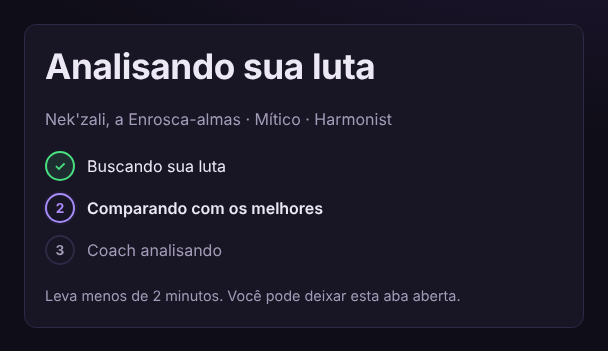
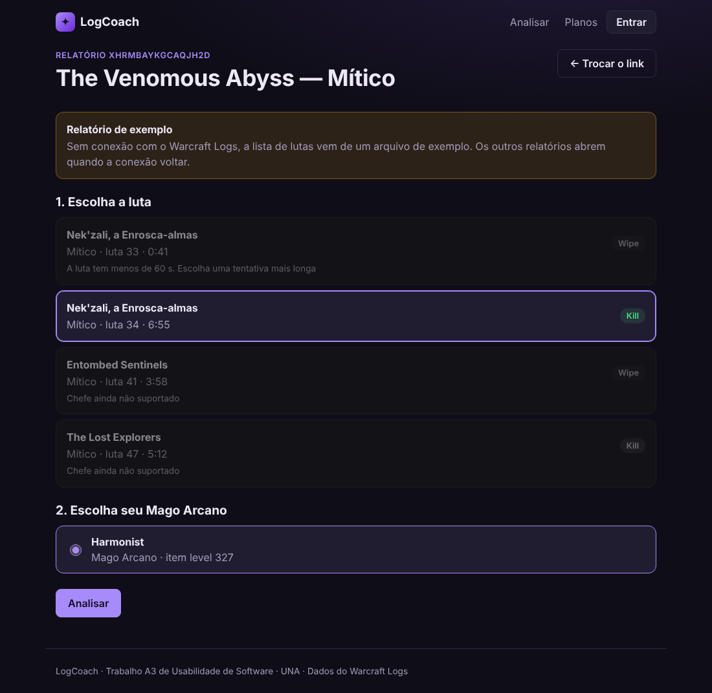
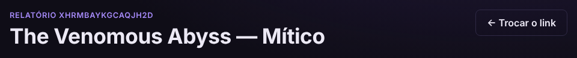
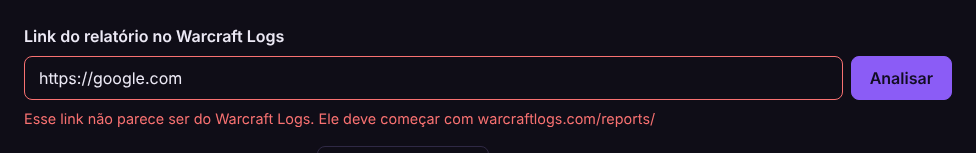
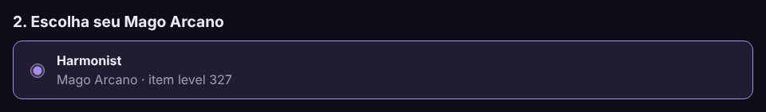
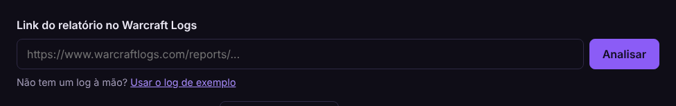
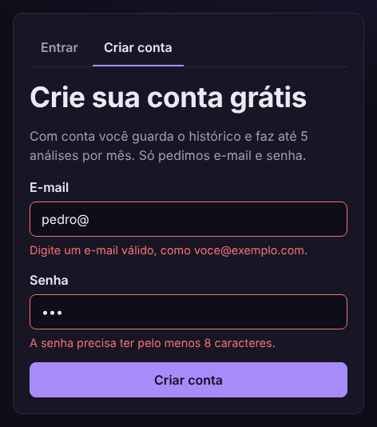
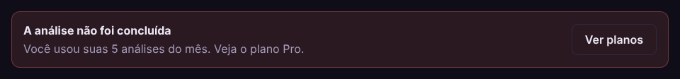

# 8. Relatório de Princípios de Usabilidade Aplicados

> Entrega da RT03. Evidências da seção 8.1 a partir da alfa; resultados da seção 8.3 após o teste com usuários.

## 8.1 Heurísticas de Nielsen aplicadas

As evidências são prints da alfa rodando (versão de 27/10/2026, relatório de exemplo do Nek'zali Mítico). As três heurísticas marcadas com "após o motor" aparecem na tela de resultado, cujos números mudam quando o motor de análise entrar; os prints delas serão tirados nessa versão.

| Heurística | Onde aparece no LogCoach | Evidência (print) |
|---|---|---|
| Visibilidade do status do sistema | Barra de progresso em etapas durante a análise: "Buscando sua luta → Comparando com os melhores → Coach analisando" | [Figura 1](#figura-1-andamento-em-etapas) |
| Correspondência com o mundo real | Interface em português, com os nomes do cliente do jogo em pt-BR ("Nek'zali, a Enrosca-almas", "Mítico", "Kill", "Wipe") | [Figura 2](#figura-2-escolher-a-luta) |
| Controle e liberdade do usuário | Botões "← Trocar o link" e "← Escolher outra luta"; o voltar do navegador funciona em todas as telas | [Figura 3](#figura-3-voltar-sem-perder-o-caminho) |
| Consistência e padrões | Mesmas cores e ícones para ok / atenção / erro nos erros, nas regras e nos avisos | _após o motor_ |
| Prevenção de erros | Link conferido antes de enviar; lutas que não podem ser analisadas aparecem em cinza, com o motivo | [Figura 4](#figura-4-link-conferido-antes-de-enviar) e [Figura 2](#figura-2-escolher-a-luta) |
| Reconhecer em vez de lembrar | O personagem da última análise (ou o único da luta) já vem marcado; os erros principais ficam no topo do resultado | [Figura 5](#figura-5-personagem-ja-marcado) |
| Flexibilidade e eficiência | Atalho "Usar o log de exemplo" para quem não tem um log à mão; usuário frequente pula a escolha do personagem | [Figura 6](#figura-6-atalho-do-log-de-exemplo) e [Figura 5](#figura-5-personagem-ja-marcado) |
| Design estético e minimalista | Resumo só com os erros de maior impacto; detalhes nas abas "Linha do tempo" e "Todas as regras" | _após o motor_ |
| Ajudar a reconhecer e corrigir erros | Mensagens no próprio campo dizendo o que fazer; limite do plano com o caminho para resolver | [Figura 7](#figura-7-erros-no-proprio-campo) e [Figura 8](#figura-8-limite-do-plano) |
| Ajuda e documentação | Termos técnicos ("bracket", "tempo ativo", tabela por habilidade) com linha pontilhada e explicação ao passar o mouse ou tocar | _após o motor_ |

### Figura 1: andamento em etapas

### Figura 2: escolher a luta

Nomes em português e lutas fora do recorte em cinza, cada uma com o motivo ("A luta tem menos de 60 s", "Chefe ainda não suportado").

### Figura 3: voltar sem perder o caminho

### Figura 4: link conferido antes de enviar

### Figura 5: personagem já marcado

### Figura 6: atalho do log de exemplo

### Figura 7: erros no próprio campo

### Figura 8: limite do plano

## 8.2 Validação de entradas e tratamento de erros

| Situação | Mensagem ao usuário |
|---|---|
| Link não é do Warcraft Logs | "Esse link não parece ser do Warcraft Logs. Ele deve começar com warcraftlogs.com/reports/" |
| Relatório privado ou inexistente | "Não conseguimos abrir esse relatório. Confira se ele está público no Warcraft Logs" |
| Luta de chefe não suportado | Luta aparece cinza: "Chefe ainda não suportado" |
| Nenhum Mago Arcano na luta | "Não achamos nenhum Mago Arcano nessa luta" |
| Luta curta demais | "A luta tem menos de 60 s. Escolha uma tentativa mais longa" |
| Limite do plano grátis | "Você usou suas 5 análises do mês. Veja o plano Pro" |
| API do Warcraft Logs fora do ar | "O Warcraft Logs não respondeu. Tente de novo em alguns minutos" |
| IA falhou | Relatório só com as regras + aviso "Explicação do coach indisponível agora" |
| E-mail ou senha inválidos | Aviso no próprio campo, antes de enviar |

## 8.3 Teste de usabilidade

- **Participantes:** 5 pessoas — 3 jogadores de WoW e 2 leigos.
- **Tarefas:** 1) analisar um log a partir do link; 2) achar o erro mais grave; 3) achar a evolução no histórico.
- **Medidas:** tempo para concluir, se precisou de ajuda, nota SUS (meta ≥ 68), tempo da 1ª análise (meta ≤ 5 min, RNF09) e taxa de sucesso (meta ≥ 80%).

### 8.3.1 Roteiro (para quem aplica)

**Antes de cada sessão (5 min)**

1. Backend e frontend rodando, com o motor na versão da entrega. Abrir http://localhost:5173 numa janela anônima, para não haver sessão nem histórico de outro participante.
2. Criar uma conta de teste (ex.: `teste1@logcoach.dev`) e fazer **duas análises** da luta de exemplo com ela. Sair da conta. Isso deixa um histórico pronto para a tarefa 3.
3. Ter à mão: o link de exemplo (em papel ou no chat), um cronômetro e esta tabela.
4. Sessão remota: o participante usa o próprio navegador se o sistema estiver publicado; senão, compartilha-se a tela e ele diz onde clicar.

**Abertura (ler para o participante)**

> Obrigado por ajudar. Vamos testar o site, não você: se algo ficar difícil, é o site que precisa melhorar. Vou pedir três tarefas. Tente fazer sozinho e vá falando em voz alta o que está pensando. Eu não vou ajudar durante as tarefas, só se você travar de vez. No final tem um questionário rápido de 10 perguntas. Leva uns 15 minutos.

**Tarefas (ler uma por vez; cronometrar do fim da leitura até concluir)**

| Tarefa | O que ler para o participante | Concluída quando | Tempo-limite |
|---|---|---|---|
| 1 | "Um amigo te mandou este link do log dele. Descubra o que o LogCoach diz sobre a luta do personagem Harmonist." (entregar o link) | Chega à tela de resultado | 5 min |
| 2 | "Pelo relatório, qual foi o erro que mais custou dano nessa luta? E o que o site sugere fazer?" | Aponta o 1º erro da lista e lê o "O que fazer" | 3 min |
| 3 | "Entre com a conta `teste1@logcoach.dev` (senha na folha) e descubra se o DPS desse jogador melhorou entre as análises." | Abre o Perfil e responde olhando o gráfico ou o histórico | 3 min |

Na tarefa 3, com o log de exemplo, as duas análises são da mesma luta: a resposta certa é que o DPS **ficou igual**. O que se mede é se a pessoa acha o Perfil e lê o histórico.

Para cada tarefa, anotar: **tempo**, **concluiu? (sim / com ajuda / não)** e **onde hesitou** (o que procurou, onde clicou errado, o que disse).

**Encerramento**

1. Aplicar o questionário SUS (8.3.2), de preferência sem o aplicador olhando as respostas.
2. Perguntar: "O que foi mais confuso?" e "O que você mudaria?". Anotar as frases como foram ditas.
3. Para os leigos, a tarefa 2 mede se o relatório se entende sem conhecer o jogo; é normal levarem mais tempo.

### 8.3.2 Questionário SUS

Cada frase é respondida de 1 (discordo totalmente) a 5 (concordo totalmente).

| # | Frase |
|---|---|
| 1 | Eu acho que gostaria de usar este sistema com frequência. |
| 2 | Eu achei o sistema desnecessariamente complexo. |
| 3 | Eu achei o sistema fácil de usar. |
| 4 | Eu acho que precisaria da ajuda de uma pessoa com conhecimento técnico para usar o sistema. |
| 5 | Eu achei que as várias funções do sistema estão bem integradas. |
| 6 | Eu achei que o sistema apresenta muita inconsistência. |
| 7 | Eu imagino que as pessoas aprenderão a usar este sistema rapidamente. |
| 8 | Eu achei o sistema muito complicado de usar. |
| 9 | Eu me senti confiante ao usar o sistema. |
| 10 | Eu precisei aprender várias coisas antes de conseguir usar o sistema. |

**Como calcular a nota de cada participante (0 a 100)**

1. Frases ímpares (1, 3, 5, 7, 9): resposta − 1.
2. Frases pares (2, 4, 6, 8, 10): 5 − resposta.
3. Somar os 10 valores e multiplicar por 2,5.

Exemplo: respostas 4, 2, 4, 1, 4, 2, 5, 1, 4, 2 → ímpares (3+3+3+4+3) = 16; pares (3+4+3+4+3) = 17; (16 + 17) × 2,5 = **82,5**.

A nota do sistema é a média dos 5 participantes. Acima de 68 é considerada acima da média (meta do RNF10).

### 8.3.3 Resultados

| Participante | Perfil | Tarefa 1 | Tarefa 2 | Tarefa 3 | SUS |
|---|---|---|---|---|---|
| P1 |  |  |  |  |  |
| P2 |  |  |  |  |  |
| P3 |  |  |  |  |  |
| P4 |  |  |  |  |  |
| P5 |  |  |  |  |  |
| **Média** |  |  |  |  |  |

Em cada tarefa, anotar o tempo e o resultado (ex.: "2:10, sim" ou "4:30, com ajuda").

**Taxa de sucesso:** tarefas concluídas sem ajuda ÷ 15 (5 participantes × 3 tarefas). Meta ≥ 80% (item 11).

**Problemas encontrados e correções:** _a preencher após o teste_.

Problema já observado num teste informal, antes do roteiro: o atalho "Usar o log de exemplo" some quando a mensagem de erro do link aparece no lugar dele.
