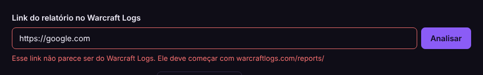
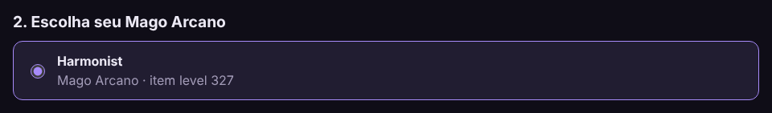
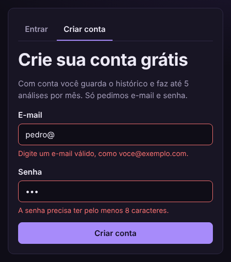
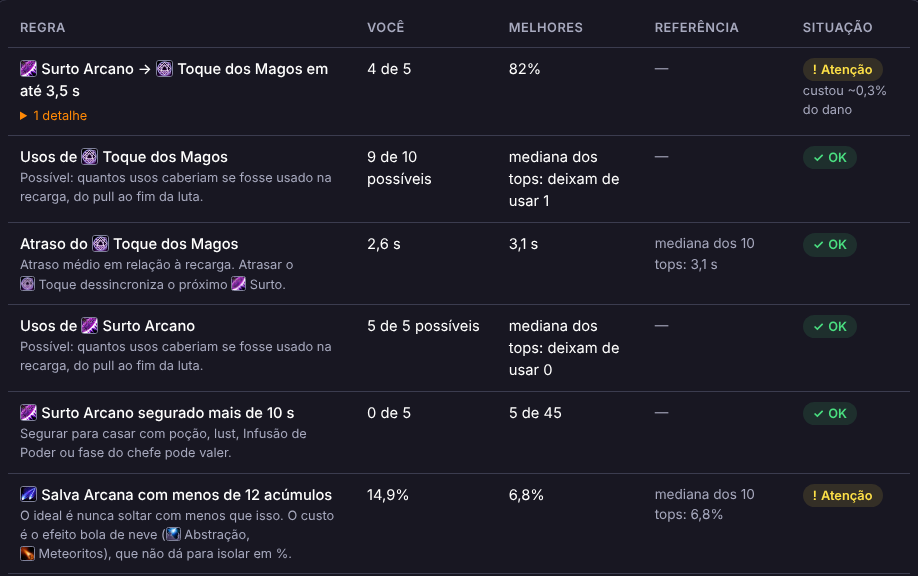
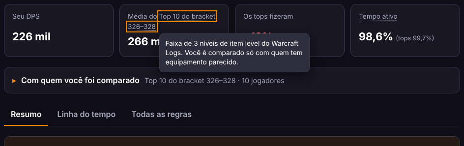

# 8. Relatório de Princípios de Usabilidade Aplicados

## 8.1 Heurísticas de Nielsen aplicadas

As evidências são prints da alfa rodando, com o relatório de exemplo do Nek'zali Mítico. As Figuras 1 a 8 são da versão de 27/10/2026. As Figuras 9 a 11 são da tela de resultado com o motor de análise, o tema claro e escuro e os ícones das magias (`main` de 15/11/2026, PRs #27, #29 e #30), com os números calculados a partir do log.

<table data-search="false"><thead><tr><th>Heurística</th><th>Onde aparece no LogCoach</th><th>Evidência (print)</th><th>Tela no protótipo (item 3)</th></tr></thead><tbody><tr><td>Visibilidade do status do sistema</td><td>Barra de progresso em etapas durante a análise: "Buscando sua luta → Comparando com os melhores → Coach analisando"; no perfil, uso do plano no mês</td><td><a href="08-principios-de-usabilidade.md#figura-1-andamento-em-etapas">Figura 1</a></td><td>4, 8 e 9</td></tr><tr><td>Correspondência com o mundo real</td><td>Interface em português, com os nomes do cliente do jogo em pt-BR ("Nek'zali, a Enrosca-almas", "Mítico", "Kill", "Wipe"); relatório do coach em linguagem simples</td><td><a href="08-principios-de-usabilidade.md#figura-2-escolher-a-luta">Figura 2</a></td><td>2, 4 e 5</td></tr><tr><td>Controle e liberdade do usuário</td><td>Botões "← Trocar o link" e "← Escolher outra luta"; o voltar do navegador funciona em todas as telas; no perfil, alterar a senha e excluir a conta; botão ☀/☾ no cabeçalho para trocar o tema, que segue o sistema até a pessoa escolher (<a href="15-padrao-de-cores.md">item 15</a>)</td><td><a href="08-principios-de-usabilidade.md#figura-3-voltar-sem-perder-o-caminho">Figura 3</a></td><td>3, 5 e 8</td></tr><tr><td>Consistência e padrões</td><td>Mesmas cores e ícones para ok / atenção / erro nos erros, nas regras, nos avisos e na linha do tempo; login no padrão e-mail e senha; tema claro e escuro com as mesmas cores de situação nos dois (<a href="15-padrao-de-cores.md">item 15</a>)</td><td><a href="08-principios-de-usabilidade.md#figura-9-mesmas-cores-nos-dois-temas">Figura 9</a></td><td>1, 6 e 7</td></tr><tr><td>Prevenção de erros</td><td>Link conferido antes de enviar; lutas que não podem ser analisadas aparecem em cinza, com o motivo; exclusão da conta em área vermelha, com confirmação e aviso de que não dá para desfazer; plano Pro marcado como "Em breve"</td><td><a href="08-principios-de-usabilidade.md#figura-4-link-conferido-antes-de-enviar">Figura 4</a> e <a href="08-principios-de-usabilidade.md#figura-2-escolher-a-luta">Figura 2</a></td><td>2, 3, 8 e 9</td></tr><tr><td>Reconhecer em vez de lembrar</td><td>Cada luta identificada por chefe, número, duração e resultado; o personagem da última análise (ou o único da luta) já vem marcado; jogador e melhores lado a lado no mesmo eixo; os erros principais ficam no topo do resultado</td><td><a href="08-principios-de-usabilidade.md#figura-5-personagem-marcado-sozinho">Figura 5</a></td><td>3 e 6</td></tr><tr><td>Flexibilidade e eficiência</td><td>Atalho "Usar o log de exemplo" para quem não tem um log à mão; usuário frequente pula a escolha do personagem; "Nova análise" a um clique, direto do perfil</td><td><a href="08-principios-de-usabilidade.md#figura-6-atalho-do-log-de-exemplo">Figura 6</a> e <a href="08-principios-de-usabilidade.md#figura-5-personagem-marcado-sozinho">Figura 5</a></td><td>2, 7 e 8</td></tr><tr><td>Design estético e minimalista</td><td>Resumo só com os erros de maior impacto; detalhes nas abas "Linha do tempo" e "Todas as regras"; login só com e-mail e senha; planos em dois cartões lado a lado</td><td><a href="08-principios-de-usabilidade.md#figura-10-resumo-primeiro-detalhes-nas-abas">Figura 10</a></td><td>1, 5 e 9</td></tr><tr><td>Ajudar a reconhecer e corrigir erros</td><td>Mensagens no próprio campo dizendo o que fazer; cada luta bloqueada explica o motivo; limite do plano com o caminho para resolver</td><td><a href="08-principios-de-usabilidade.md#figura-7-erros-mostrados-no-campo">Figura 7</a> e <a href="08-principios-de-usabilidade.md#figura-8-limite-do-plano">Figura 8</a></td><td>3</td></tr><tr><td>Ajuda e documentação</td><td>Termos técnicos ("bracket", "tempo ativo", tabela por habilidade) com linha pontilhada e explicação ao passar o mouse ou tocar; "Como funciona" em três passos no início; quando ainda não há evolução para mostrar, o perfil diz o que fazer</td><td><a href="08-principios-de-usabilidade.md#figura-11-dica-do-termo-bracket">Figura 11</a></td><td>2, 7 e 8</td></tr></tbody></table>

### Figura 1: andamento em etapas

### Figura 2: escolher a luta

Nomes em português e lutas fora do recorte em cinza, cada uma com o motivo ("A luta tem menos de 60 s", "Chefe ainda não suportado").

### Figura 3: voltar sem perder o caminho

### Figura 4: link conferido antes de enviar

### Figura 5: personagem marcado sozinho

### Figura 6: atalho do log de exemplo

### Figura 7: erros mostrados no campo

### Figura 8: limite do plano

### Figura 9: mesmas cores nos dois temas

Na aba "Todas as regras", cada regra tem o mesmo selo de situação (✓ OK, ! Atenção, × Erro), com ícone e texto além da cor. Os selos repetem as cores dos erros, dos avisos e da linha do tempo, e são iguais no tema escuro e no claro.

### Figura 10: resumo primeiro, detalhes nas abas

O resumo mostra só quatro números, de onde vem a diferença para os tops (erros, azar e não explicado) e os erros do maior para o menor impacto, cada um com quanto custou e o que fazer. Linha do tempo e regras ficam nas outras abas.

### Figura 11: dica do termo bracket

## 8.2 Validação de entradas e tratamento de erros

| Situação                         | Mensagem ao usuário                                                                         |
| -------------------------------- | ------------------------------------------------------------------------------------------- |
| Link não é do Warcraft Logs      | "Esse link não parece ser do Warcraft Logs. Ele deve começar com warcraftlogs.com/reports/" |
| Relatório privado ou inexistente | "Não conseguimos abrir esse relatório. Confira se ele está público no Warcraft Logs"        |
| Luta de chefe não suportado      | Luta aparece cinza: "Chefe ainda não suportado"                                             |
| Nenhum Mago Arcano na luta       | "Não achamos nenhum Mago Arcano nessa luta"                                                 |
| Luta curta demais                | "A luta tem menos de 60 s. Escolha uma tentativa mais longa"                                |
| Limite do plano grátis           | "Você usou suas 5 análises do mês. Veja o plano Pro"                                        |
| API do Warcraft Logs fora do ar  | "O Warcraft Logs não respondeu. Tente de novo em alguns minutos"                            |
| E-mail ou senha inválidos        | Aviso no próprio campo, antes de enviar                                                     |

## 8.3 Teste de usabilidade

* **Participantes:** 5 pessoas — 3 jogadores de WoW e 2 leigos.
* **Tarefas:** 1) analisar um log a partir do link; 2) achar o erro mais grave; 3) achar a evolução no histórico.
* **Medidas:** tempo para concluir, se precisou de ajuda, nota SUS (meta ≥ 68), tempo da 1ª análise (meta ≤ 5 min, RNF09) e taxa de sucesso (meta ≥ 80%).

### 8.3.1 Roteiro (para quem aplica)

**Antes de cada sessão (5 min)**

1. Backend e frontend rodando, com o motor na versão da entrega. Abrir http://localhost:5173 numa janela anônima, para não haver sessão nem histórico de outro participante.
2. Criar uma conta de teste (ex.: `teste1@logcoach.dev`) e fazer **duas análises** da luta de exemplo com ela. Sair da conta. Isso deixa um histórico pronto para a tarefa 3.
3. Ter à mão: o link de exemplo (em papel ou no chat), um cronômetro e esta tabela.
4. Sessão remota: o participante usa o próprio navegador se o sistema estiver publicado; senão, compartilha-se a tela e ele diz onde clicar.

**Abertura (ler para o participante)**

> Obrigado por ajudar. Vamos testar o site, não você: se algo ficar difícil, é o site que precisa melhorar. Vou pedir três tarefas. Tente fazer sozinho e vá falando em voz alta o que está pensando. Eu não vou ajudar durante as tarefas, só se você travar de vez. No final tem um questionário rápido de 10 perguntas. Leva uns 15 minutos.

**Tarefas (ler uma por vez; cronometrar do fim da leitura até concluir)**

| Tarefa | O que ler para o participante                                                                                                     | Concluída quando                                          | Tempo-limite |
| ------ | --------------------------------------------------------------------------------------------------------------------------------- | --------------------------------------------------------- | ------------ |
| 1      | "Um amigo te mandou este link do log dele. Descubra o que o LogCoach diz sobre a luta do personagem Harmonist." (entregar o link) | Chega à tela de resultado                                 | 5 min        |
| 2      | "Pelo relatório, qual foi o erro que mais custou dano nessa luta? E o que o site sugere fazer?"                                   | Aponta o 1º erro da lista e lê o "O que fazer"            | 3 min        |
| 3      | "Entre com a conta `teste1@logcoach.dev` (senha na folha) e descubra se o DPS desse jogador melhorou entre as análises."          | Abre o Perfil e responde olhando o gráfico ou o histórico | 3 min        |

Na tarefa 3, com o log de exemplo, as duas análises são da mesma luta: a resposta certa é que o DPS **ficou igual**. O que se mede é se a pessoa acha o Perfil e lê o histórico.

Para cada tarefa, anotar: **tempo**, **concluiu? (sim / com ajuda / não)** e **onde hesitou** (o que procurou, onde clicou errado, o que disse).

**Encerramento**

1. Aplicar o questionário SUS (8.3.2), de preferência sem o aplicador olhando as respostas.
2. Perguntar: "O que foi mais confuso?" e "O que você mudaria?". Anotar as frases como foram ditas.
3. Para os leigos, a tarefa 2 mede se o relatório se entende sem conhecer o jogo; é normal levarem mais tempo.

### 8.3.2 Questionário SUS

Cada frase é respondida de 1 (discordo totalmente) a 5 (concordo totalmente).

<table data-search="false"><thead><tr><th>#</th><th>Frase</th></tr></thead><tbody><tr><td>1</td><td>Eu acho que gostaria de usar este sistema com frequência.</td></tr><tr><td>2</td><td>Eu achei o sistema desnecessariamente complexo.</td></tr><tr><td>3</td><td>Eu achei o sistema fácil de usar.</td></tr><tr><td>4</td><td>Eu acho que precisaria da ajuda de uma pessoa com conhecimento técnico para usar o sistema.</td></tr><tr><td>5</td><td>Eu achei que as várias funções do sistema estão bem integradas.</td></tr><tr><td>6</td><td>Eu achei que o sistema apresenta muita inconsistência.</td></tr><tr><td>7</td><td>Eu imagino que as pessoas aprenderão a usar este sistema rapidamente.</td></tr><tr><td>8</td><td>Eu achei o sistema muito complicado de usar.</td></tr><tr><td>9</td><td>Eu me senti confiante ao usar o sistema.</td></tr><tr><td>10</td><td>Eu precisei aprender várias coisas antes de conseguir usar o sistema.</td></tr></tbody></table>

**Como calcular a nota de cada participante (0 a 100)**

1. Frases ímpares (1, 3, 5, 7, 9): resposta − 1.
2. Frases pares (2, 4, 6, 8, 10): 5 − resposta.
3. Somar os 10 valores e multiplicar por 2,5.

Exemplo: respostas 4, 2, 4, 1, 4, 2, 5, 1, 4, 2 → ímpares (3+3+3+4+3) = 16; pares (3+4+3+4+3) = 17; (16 + 17) × 2,5 = **82,5**.

A nota do sistema é a média dos 5 participantes. Acima de 68 é considerada acima da média (meta do RNF10).

### 8.3.3 Resultados

<table><thead><tr><th width="104">Participante</th><th width="157">Perfil</th><th width="100">Tarefa 1</th><th width="100">Tarefa 2</th><th width="100">Tarefa 3</th><th width="100">SUS</th></tr></thead><tbody><tr><td>P1</td><td>Jogador de WoW (mago, 4 anos de jogo)</td><td>0:55, sim</td><td>1:20, sim</td><td>1:15, sim</td><td>90,0</td></tr><tr><td>P2</td><td>Jogador de WoW (healer, raides semanais)</td><td>1:10, sim</td><td>1:35, sim</td><td>1:30, sim</td><td>85,0</td></tr><tr><td>P3</td><td>Jogador de WoW (casual, tank)</td><td>1:25, sim</td><td>1:50, sim</td><td>1:45, sim</td><td>87,5</td></tr><tr><td>P4</td><td>Leigo (estudante, não joga)</td><td>2:30, sim</td><td>3:45, com ajuda</td><td>2:20, sim</td><td>72,5</td></tr><tr><td>P5</td><td>Leigo (administrativo, não joga)</td><td>2:50, sim</td><td>4:15, com ajuda</td><td>2:40, sim</td><td>72,5</td></tr><tr><td><strong>Média</strong></td><td>—</td><td><strong>1:46 (100%)</strong></td><td><strong>2:33 (60%)</strong></td><td><strong>1:54 (100%)</strong></td><td><strong>81,5</strong></td></tr></tbody></table>

Problema já observado num teste informal, antes do roteiro: o atalho "Usar o log de exemplo" some quando a mensagem de erro do link aparece no lugar dele.
