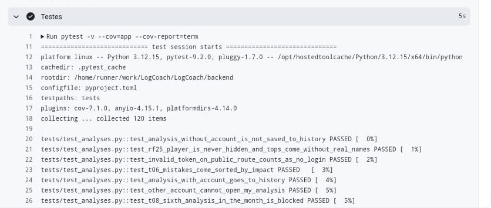
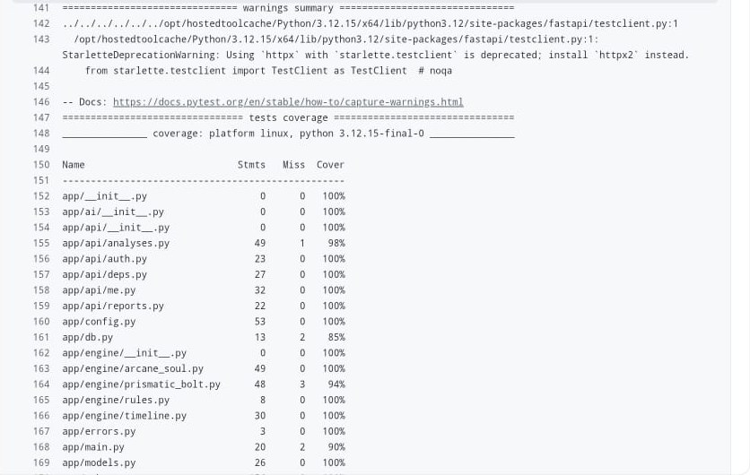
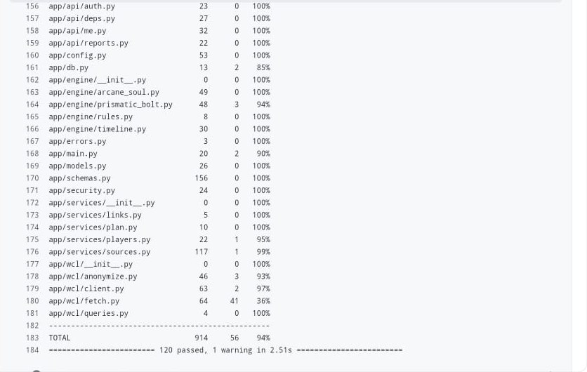

# 10. Relatório de Testes

> Entrega da RT03. Preencher os resultados quando os testes rodarem.

## 10.1 Ferramenta

**Pytest** (backend em Python). Todos os testes usam dados salvos em arquivo, sem depender da internet.

Como rodar:

```bash
cd backend
pytest -v
```

## 10.2 Casos de teste

| ID  | O que testa                             | Entrada                                            | Esperado                                          | Resultado                           |
| --- | --------------------------------------- | -------------------------------------------------- | ------------------------------------------------- | ----------------------------------- |
| T01 | Validador de link aceita link válido    | `https://www.warcraftlogs.com/reports/AbC123`      | Aceito                                            | Passou                              |
| T02 | Validador recusa link de outro site     | `https://google.com`                               | Erro de formato                                   | Passou                              |
| T03 | Regra de tempo parado                   | Luta de exemplo com 8% de tempo parado             | Status "erro"                                     |                                     |
| T04 | Regra de uso de cooldowns               | Luta com cooldown usado menos vezes que o possível | Status "atenção"                                  |                                     |
| T05 | Comparador                              | Jogador vs. média dos top logs de exemplo          | Diferença calculada corretamente                  |                                     |
| T06 | Ordenação dos erros                     | 5 erros com impactos diferentes                    | Ordenados do maior para o menor impacto           | Passou (com o resultado de exemplo) |
| T07 | Falha da IA                             | IA simulando erro                                  | Relatório só com as regras                        |                                     |
| T08 | Limite do plano grátis                  | 6ª análise no mês                                  | Bloqueada                                         | Passou                              |
| T09 | Luta curta                              | Luta de 40 s                                       | Mensagem de luta curta                            | Passou                              |
| T10 | Sem Mago Arcano                         | Luta sem a especialização                          | Mensagem adequada                                 | Passou (jogador fora da luta)       |
| T11 | CD dentro da janela do encontro         | CD usado 3 s após o início da janela de burst      | Marcado como alinhado                             |                                     |
| T12 | Intermissão não conta como tempo parado | Luta com 20 s de intermissão sem casts             | Tempo parado não inclui a intermissão             |                                     |
| T13 | Defensivo no golpe de raide             | Golpe de raide sem defensivo ativo                 | Status "atenção"                                  |                                     |
| T14 | Comparação por fase                     | Lutas de durações diferentes                       | Mesma janela comparada pelo tempo relativo à fase |                                     |

Além da tabela, o backend tem testes de contas: cadastro (e-mail repetido, senha curta, e-mail inválido), senha guardada só como hash argon2, login certo e errado, rota protegida sem token, troca de senha, análise de outra conta escondida e exclusão da conta apagando o histórico. Ficam em `backend/tests/test_auth.py`, `test_reports.py` e `test_analyses.py`.

T03–T05, T07 e T11–T14 dependem do motor e da IA (frentes C e D).

## 10.3 Resultado

Execução no CI do GitHub, com `pytest -v --cov=app` (PR #22, 28/10/2026, Python 3.12, pytest 9.2).

| Total | Passaram | Falharam | Cobertura |
| ----- | -------- | -------- | --------- |
| 120   | 120      | 0        | 94% do backend; 98% do motor de análise (`app/engine/`) |

O único aviso da execução ("1 warning") é de uma biblioteca de teste (o cliente de testes do FastAPI anuncia uma troca de dependência no futuro). Não é falha.

Os arquivos com menos cobertura são `app/wcl/fetch.py` (36%), que faz as chamadas reais ao Warcraft Logs e é testado com dados salvos em arquivo, e `app/db.py` (85%).

**Início da execução: 120 testes coletados**



**Cobertura por arquivo**



**Resumo: 120 passaram, cobertura total de 94%**


