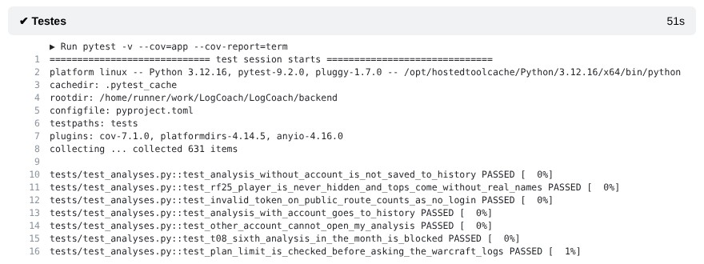
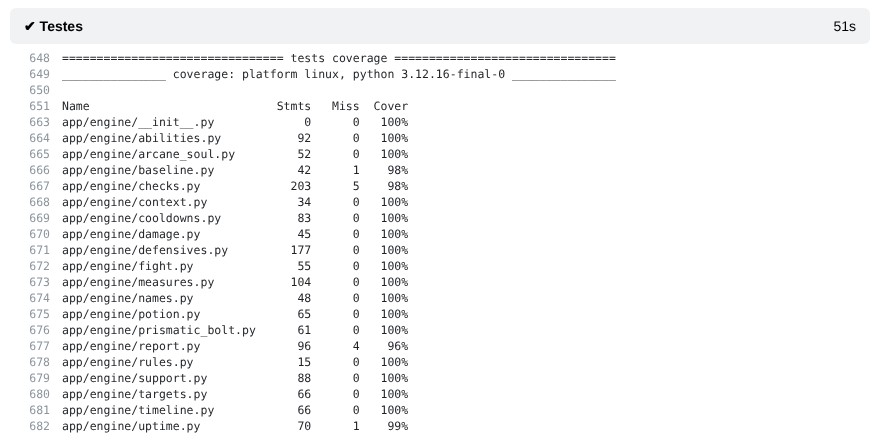
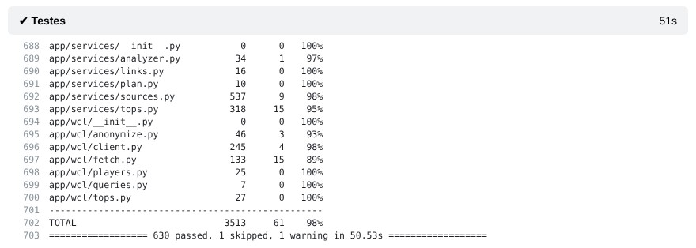

# 10. Relatório de Testes

> Entrega da RT03. Resultados do backend de 16/11/2026 (CI do PR #31, com a `main` de 15/11 e o motor de análise); do frontend, de 07/11 (item 10.4).

## 10.1 Ferramenta

**Pytest** (backend em Python). Todos os testes usam dados salvos em arquivo, sem depender da internet.

Como rodar:

```bash
cd backend
pytest -q              # ou pytest -v para ver cada teste
pytest --cov=app       # com a cobertura por arquivo (a mesma conta do CI)
```

## 10.2 Casos de teste

<table><thead><tr><th width="98.51666259765625">ID</th><th width="144.9666748046875">O que testa</th><th width="182.2999267578125">Entrada</th><th width="174.7833251953125">Esperado</th><th width="136.21661376953125">Resultado</th></tr></thead><tbody><tr><td>T01</td><td>Validador de link aceita link válido</td><td><code>https://www.warcraftlogs.com/reports/AbC123</code></td><td>Aceito</td><td>Passou</td></tr><tr><td>T02</td><td>Validador recusa link de outro site</td><td><code>https://google.com</code></td><td>Erro de formato</td><td>Passou</td></tr><tr><td>T03</td><td>Regra de tempo parado</td><td>Luta de exemplo com 8% de tempo parado</td><td>Status "erro"</td><td>Passou (<code>test_engine_rules.py</code>, <code>test_t03_*</code>)</td></tr><tr><td>T04</td><td>Regra de uso de cooldowns</td><td>Luta com cooldown usado menos vezes que o possível</td><td>Status "atenção"</td><td>Passou (<code>test_engine_rules.py</code>, <code>test_t04_cooldown_used_less_than_possible</code>)</td></tr><tr><td>T05</td><td>Comparador</td><td>Jogador vs. média dos top logs de exemplo</td><td>Diferença calculada corretamente</td><td>Passou (<code>test_engine_base.py</code>, <code>test_t05_top_value_is_the_mean_of_the_tops</code>)</td></tr><tr><td>T06</td><td>Ordenação dos erros</td><td>5 erros com impactos diferentes</td><td>Ordenados do maior para o menor impacto</td><td>Passou (motor, <code>test_e2e_t06_mistakes_come_sorted_by_impact</code>)</td></tr><tr><td>T08</td><td>Limite do plano grátis</td><td>6ª análise no mês</td><td>Bloqueada</td><td>Passou</td></tr><tr><td>T09</td><td>Luta curta</td><td>Luta de 40 s</td><td>Mensagem de luta curta</td><td>Passou</td></tr><tr><td>T10</td><td>Sem Mago Arcano</td><td>Luta sem a especialização</td><td>Mensagem adequada</td><td>Passou (jogador fora da luta)</td></tr><tr><td>T11</td><td>CD dentro da janela do encontro</td><td>CD usado 3 s após o início da janela de burst</td><td>Marcado como alinhado</td><td>Passou (<code>test_engine_rules.py</code>, <code>test_t11_surge_held_for_the_boss_phase_is_aligned</code>)</td></tr><tr><td>T12</td><td>Intermissão não conta como tempo parado</td><td>Luta com 20 s de intermissão sem casts</td><td>Tempo parado não inclui a intermissão</td><td>Passou (<code>test_engine_rules.py</code>, <code>test_t12_intermission_without_targets_is_not_idle_time</code>)</td></tr><tr><td>T13</td><td>Defensivo no pico de dano</td><td>Pico de 70% da vida em 2 s, vida a 30%, defensivo pronto e não usado</td><td>Status "atenção"</td><td>Passou (<code>test_engine_peaks.py</code>, <code>test_t13_big_raid_hit_without_defensive_is_attention</code>)</td></tr><tr><td>T14</td><td>Comparação por fase</td><td>Lutas de durações diferentes</td><td>Mesma janela comparada pelo tempo relativo à fase</td><td>Passou (<code>test_engine_base.py</code>, <code>test_t14_phases_of_different_lengths_compare_by_rate</code>)</td></tr></tbody></table>

Além da tabela, o backend tem testes de contas: cadastro (e-mail repetido, senha curta, e-mail inválido), senha guardada só como hash argon2, login certo e errado, rota protegida sem token, troca de senha, análise de outra conta escondida e exclusão da conta apagando o histórico. Ficam em `backend/tests/test_auth.py`, `test_reports.py` e `test_analyses.py`.

T03–T05 e T11–T14 passam com o motor de análise. O T13 mudou junto com a decisão de 03/11: em vez de procurar o golpe de raide sem defensivo, o motor acha os **picos de dano** no log (60% da vida em 4 s ou vida abaixo de 35%) e diz se um defensivo cabia.

## 10.3 Resultado

Execução no CI do GitHub em 16/11/2026, com `pytest -v --cov=app` (PR #31, com a `main` de 15/11; Python 3.12, pytest 9.2; cerca de 50 s, sem internet). No Windows o resultado foi o mesmo.

<table><thead><tr><th width="71.7166748046875">Total</th><th width="90.60003662109375">Passaram</th><th width="80.75">Pulados</th><th width="87.2667236328125">Falharam</th><th width="384.11651611328125">Cobertura</th></tr></thead><tbody><tr><td>631</td><td>630</td><td>1</td><td>0</td><td>98% do backend (3.513 linhas, 61 sem teste); 99% do motor (<code>app/engine/</code>: 1.462 linhas, 11 sem teste)</td></tr></tbody></table>

O teste pulado é de propósito: `test_sample_copies_have_no_real_names` confere as cópias de exemplo contra o arquivo de nomes reais (`names.local.json`), que só existe na máquina de quem baixou as fixtures e nunca vai para o repositório (RF25). O único aviso ("1 warning") vem de uma biblioteca de teste e não é falha.

Os arquivos com menos cobertura são `app/wcl/fetch.py` (89%), que faz as chamadas reais ao Warcraft Logs e é testado com dados salvos em arquivo, `app/wcl/anonymize.py` (93%) e `app/services/tops.py` (95%).

Testes do motor de análise (127 no total), por arquivo em `backend/tests/`:

<table><thead><tr><th width="273.183349609375">Arquivo</th><th width="83.38330078125">Testes</th><th width="356.60009765625">O que cobre</th></tr></thead><tbody><tr><td><code>test_engine_rules.py</code></td><td>40</td><td>Regras do Mago Arcano (T03, T04, T11, T12) e o kill de referência</td></tr><tr><td><code>test_engine_support.py</code></td><td>31</td><td>Dano creditado ao Evocador Aumentação que apoiou o jogador</td></tr><tr><td><code>test_engine_peaks.py</code></td><td>19</td><td>Picos de dano e defensivos (T13)</td></tr><tr><td><code>test_engine_base.py</code></td><td>17</td><td>Fases, referência dos tops, tabelas por habilidade e por alvo (T05, T14)</td></tr><tr><td><code>test_engine_timeline.py</code></td><td>7</td><td>Janelas e acúmulos de buffs na linha do tempo</td></tr><tr><td><code>test_engine_arcane_soul.py</code></td><td>5</td><td>Entrada no Arcane Soul e Arcane Blast no Surge</td></tr><tr><td><code>test_engine_report.py</code></td><td>5</td><td>Montagem do <code>AnalysisResult</code></td></tr><tr><td><code>test_engine_prismatic_bolt.py</code></td><td>3</td><td>Prismatic Bolt: decisão × sorte</td></tr></tbody></table>

Além deles, `test_analyzer.py` (11) testa o `EngineAnalyzer`; os outros arquivos cobrem contas, rotas, fontes de dados, cliente do Warcraft Logs e busca dos tops.

**Início da execução: 631 testes coletados**



**Cobertura do motor de análise, por arquivo**



**Resumo: 630 passaram, 1 pulado, cobertura total de 98%**



## 10.4 Testes do frontend

O frontend (React + Vite) tem três camadas de teste automatizado, todas com dados reais da API salvos em arquivo (`frontend/src/test/fixtures/`, só pseudônimos) e sem depender do backend, do Warcraft Logs ou da internet.

<table><thead><tr><th width="142.0999755859375">Tipo</th><th width="164.2666015625">Ferramenta</th><th width="191.0833740234375">Onde</th><th width="229.2833251953125">O que cobre</th></tr></thead><tbody><tr><td>Unidade</td><td>Vitest</td><td><code>src/lib/*.test.js</code></td><td>Funções puras e módulos de apoio: cliente da API e erros, validador de link (T01, T02), formatação, roteador por hash, tema, armazenamento com falha</td></tr><tr><td>Componente</td><td>Vitest + Testing Library</td><td><code>src/components/*.test.jsx</code></td><td>Cada componente isolado: estados, textos em português, teclado e atributos ARIA</td></tr><tr><td>Integração das telas</td><td>Vitest + Testing Library, com a API simulada (<code>src/test/mockApi.js</code>)</td><td><code>src/pages/*.test.jsx</code>, <code>src/App.test.jsx</code></td><td>Cada tela conversando com a API: caminhos, corpos, cabeçalho <code>Authorization</code>, erros por <code>code</code> (item 12.3), limite do plano, RF25</td></tr><tr><td>Acessibilidade</td><td>axe-core</td><td>dentro dos testes acima e em <code>e2e/theme.spec.js</code></td><td>No jsdom, regras do axe (sem contraste, que o jsdom não calcula); no navegador, o axe completo, com contraste</td></tr><tr><td>Tema e paletas</td><td>Vitest e Playwright</td><td><code>src/theme-contrast.test.js</code>, <code>src/lib/theme.test.js</code>, <code>e2e/theme.spec.js</code></td><td>Contraste WCAG AA dos tokens das duas paletas (<code>docs/15</code>), script do <code>index.html</code> igual ao <code>theme.js</code>, tema no navegador</td></tr><tr><td>Ponta a ponta</td><td>Playwright (Chromium)</td><td><code>frontend/e2e/</code></td><td>O site construído (<code>npm run build</code> + <code>preview</code>) num navegador de verdade, com a API simulada por <code>page.route</code></td></tr></tbody></table>

**Testes ponta a ponta (Playwright).** `e2e/flows.spec.js` percorre os fluxos principais: colar o link do kill de referência, lista de lutas (indisponíveis em cinza, com o motivo), escolher a luta e o Mago, pré-busca, análise com o corpo certo e resultado com a diferença para os tops, nomes ocultos (RF25) e aviso de exemplo; link inválido, Warcraft Logs fora do ar (`wcl_unavailable`), relatório privado, falha ao buscar os Magos, login, cadastro, sessão vencida e limite do plano (`plan_limit`, T08). `e2e/theme.spec.js` cobre o que o jsdom não consegue: primeira visita seguindo o sistema (claro e escuro) com a cor de fundo computada igual ao token, botão de alternar, escolha salva no reload e acima do sistema, ausência de flash (o `data-theme` já está certo antes de o React rodar, com o bundle segurado), `localStorage` bloqueado, celular 360×740 sem rolagem horizontal, e o axe-core com a regra de contraste ligada nas duas paletas em sete telas (início, login, cadastro, planos, escolher luta, resultado, resultado com nomes à mostra), exigindo zero violações sérias ou críticas.

Como rodar:

```bash
cd frontend
npm install
npm test                          # Vitest (unidade, componente, telas)
npx playwright install chromium   # só na primeira vez (baixa o navegador)
npm run test:e2e                  # Playwright; sobe o build sozinho na porta 4173
npm run lint
```

### Resultado (07/11/2026, branch `feat/tema-claro-escuro`)

<table><thead><tr><th width="263.583251953125">Suíte</th><th width="86.683349609375">Arquivos</th><th width="71.4666748046875">Testes</th><th width="89.8167724609375">Passaram</th><th width="89.60009765625">Falharam</th><th width="95.4163818359375">Duração</th></tr></thead><tbody><tr><td>Vitest (<code>npm test</code>)</td><td>30</td><td>520</td><td>520</td><td>0</td><td>~10 s</td></tr><tr><td>Playwright (<code>npm run test:e2e</code>)</td><td>2</td><td>43</td><td>43</td><td>0</td><td>~15 s</td></tr></tbody></table>

No CI de 16/11/2026 (PR #31, com a `main` de 15/11, já com os ícones das magias): Vitest com 32 arquivos e 601 testes, todos passando; Playwright com 47 testes, todos passando (\~23 s).

Vitest por pasta: `src/lib` (9 arquivos), `src/components` (13), `src/pages` (6) e `src/` (2: `App.test.jsx`, `theme-contrast.test.js`). O Playwright rodou verde e estável em 3 rodadas seguidas. O Vitest roda com fuso fixo (`TZ=America/Sao_Paulo`, em `vite.config.js`), para datas e horas saírem iguais em qualquer máquina e no CI.

**CI** (`.github/workflows/ci.yml`, Node 22): o job do frontend roda lint, Vitest e build em Ubuntu e Windows; o job `frontend-e2e` roda o Playwright só no Ubuntu (o navegador é o mesmo nos dois sistemas e o download pesa), com `retries: 1` e os rastros de falha anexados como artefato.
