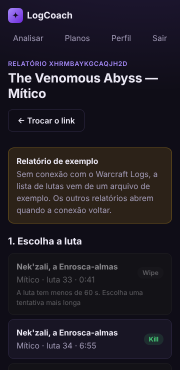

# 11. Métricas de Qualidade

> Entrega da RT03 / banca. Lint, testes, carregamento, tempo de análise e responsividade já medidos (04/11, com o motor na `main`). A cobertura do motor ainda não foi medida (falta instalar o `pytest-cov`); tempo da 1ª análise, SUS e taxa de sucesso vêm do teste de usabilidade (item 8.3).

| Métrica | Meta | Como medir | Resultado |
|---|---|---|---|
| Testes passando | 100% | `pytest` no CI | **100%** — 604 de 604 (04/11), 126 deles do motor (ver item 10.3) |
| Cobertura de testes do motor de análise | ≥ 70% | `pytest --cov=app/engine` | Não medida: o `pytest-cov` ainda não está nas dependências |
| Erros de lint | 0 | `ruff check` e `eslint` no CI | **0** — CI verde no backend e no frontend (commit `91531b0`, 27/10) |
| Tempo de carregamento das páginas | < 3 s (RNF01) | DevTools do navegador | **0,7 s em 4G e 1,8 s em 3G rápido** — tela inicial, build de produção (mediana de 5 medições, ver 11.1) |
| Tempo de uma análise completa | < 2 min (RNF02) | Log do backend | **~1,1 s** pela rota no modo exemplo (kill de referência); no modo real, com os eventos já pré-buscados e o bracket no cache, a análise só roda o motor. A primeira busca dos tops de um bracket leva até ~2,5 min, mas é feita na pré-busca, em segundo plano (ver 11.3) |
| Tempo da 1ª análise por usuário novo | ≤ 5 min (RNF09) | Teste de usabilidade | |
| Nota SUS | ≥ 68 | Questionário SUS (item 8) | |
| Taxa de sucesso nas tarefas do teste | ≥ 80% | Teste de usabilidade | |
| Responsividade | OK de 360 px a desktop | Teste manual em celular e PC | **OK** — sem rolagem lateral a 360 px em todas as telas; testado no celular de um integrante (ver 11.2) |

## 11.1 Como o tempo de carregamento foi medido

- **O quê:** do pedido da página até a tela inicial aparecer com o título, no Chromium, com cache vazio a cada medição.
- **Versão:** frontend da `main` em 27/10, compilado para produção (JavaScript de 240 KB, 76 KB comprimido), servido sem compressão. Com o sistema publicado e compressão ligada (item 13), o tempo tende a cair.
- **Redes simuladas:** sem limite 0,15 s · 4G (4 Mbps, 20 ms) 0,71 s · 3G rápido (1,6 Mbps, 150 ms) 1,75 s. Todas abaixo da meta de 3 s.
- **Refazer na banca** com o sistema publicado, pela aba Network do DevTools (F12), para medir com a rede real.

## 11.2 Responsividade

Telas conferidas a 360 px de largura (celular pequeno) e a 1100 px (desktop): início, login, escolha da luta, andamento, resultado com as três abas, perfil e planos. Nenhuma rola para o lado; a linha do tempo empilha os rótulos acima das barras no celular.

 

## 11.3 Tempo de uma análise

- **Modo exemplo** (`DATA_SOURCE=exemplo`): `POST /analyses` com o kill de referência (Harmonist, Nek'zali Mítico, 6:55) contra os 10 tops do bracket leva **~1,1 s** do pedido à resposta, com o motor completo.
- **Modo real** (`DATA_SOURCE=wcl`): quando a pessoa escolhe o personagem, a pré-busca baixa os eventos da luta e, se o bracket ainda não estiver guardado, os tops (item 12.13). Na hora de analisar, eventos e tops já estão na memória ou no banco (24 h), e a análise roda só o motor.
- **Primeira busca de um bracket:** os 11 tops levaram entre ~53 s e ~2,5 min nas medições de 04/11 (varia com o Warcraft Logs). Como acontece em segundo plano, enquanto a pessoa ainda está na tela de escolha, não entra no tempo da análise; quem analisa antes de ela terminar espera a mesma busca.
