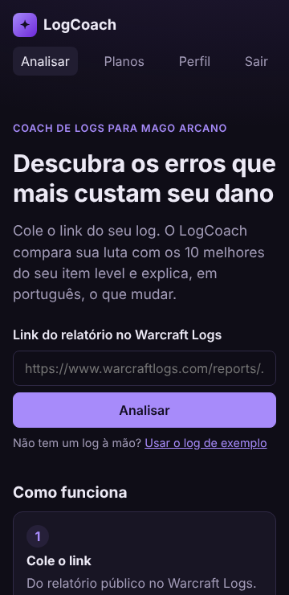
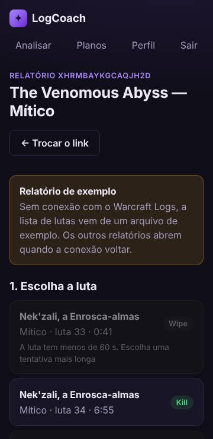

# 11. Métricas de Qualidade

> Entrega da RT03 / banca. Testes, lint, carregamento e responsividade já medidos. Cobertura do motor e tempo de uma análise completa entram com o motor ligado; tempo da 1ª análise, SUS e taxa de sucesso vêm do teste de usabilidade (item 8.3).

| Métrica | Meta | Como medir | Resultado |
|---|---|---|---|
| Testes passando | 100% | `pytest` no CI | **100%** — 120 testes do backend passando e CI verde (PR #20 e `main` em `b842fcf`, 28/10). O print da saída entra no item 10.3 |
| Cobertura de testes do motor de análise | ≥ 70% | `pytest --cov=app/engine` | |
| Erros de lint | 0 | `ruff check` e `eslint` no CI | **0** — CI verde no backend e no frontend (`main` em `b842fcf`, 28/10) |
| Tempo de carregamento das páginas | < 3 s (RNF01) | DevTools do navegador | **0,7 s em 4G e 1,8 s em 3G rápido** — tela inicial, build de produção (mediana de 5 medições, ver 11.1) |
| Tempo de uma análise completa | < 2 min (RNF02) | Log do backend | |
| Tempo da 1ª análise por usuário novo | ≤ 5 min (RNF09) | Teste de usabilidade | |
| Nota SUS | ≥ 68 | Questionário SUS (item 8) | |
| Taxa de sucesso nas tarefas do teste | ≥ 80% | Teste de usabilidade | |
| Responsividade | OK de 360 px a desktop | Teste manual em celular e PC | **OK** — sem rolagem lateral a 360 px em todas as telas; testado no celular de um integrante (ver 11.2) |

## 11.1 Como o tempo de carregamento foi medido

- **O quê:** do pedido da página até a tela inicial aparecer com o título, no Chromium, com cache vazio a cada medição.
- **Versão:** frontend da `main` em 27/10, compilado para produção (JavaScript de 240 KB, 76 KB comprimido), servido sem compressão. Com o sistema publicado e compressão ligada (item 13), o tempo tende a cair.
- **Redes simuladas:** sem limite 0,15 s · 4G (4 Mbps, 20 ms) 0,71 s · 3G rápido (1,6 Mbps, 150 ms) 1,75 s. Todas abaixo da meta de 3 s.
- **Refazer na banca** com o sistema publicado, pela aba Network do DevTools (F12), para medir com a rede real.

## 11.2 Responsividade

Telas conferidas a 360 px de largura (celular pequeno) e a 1100 px (desktop): início, login, escolha da luta, andamento, resultado com as três abas, perfil e planos. Nenhuma rola para o lado; a linha do tempo empilha os rótulos acima das barras no celular.

 

