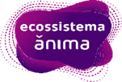

# LogCoach

**Coach de desempenho para jogadores competitivos de World of Warcraft.**

O jogador cola o link do seu log de combate do Warcraft Logs e o LogCoach mostra, em português, os erros que mais estão custando dano, comparando a luta com os melhores jogadores do mundo no mesmo chefe. A proposta é reduzir drasticamente o tempo entre jogar e saber o que corrigir.

|                    |                                                                           |
| ------------------ | ------------------------------------------------------------------------- |
| **Curso**          | Engenharia de Software — UNA                                              |
| **Trabalho**       | A3 — Usabilidade de Software                                              |
| **Tipo**           | Aplicação Web responsiva                                                  |
| **Setor**          | Entretenimento e Esportes Eletrônicos                                     |
| **Recorte do MVP** | Mago Arcano · raide The Venomous Abyss (Midnight T2) · Mítico · português |
| **Repositório**    | [github.com/jp4inbr/LogCoach](https://github.com/jp4inbr/LogCoach)        |

***

## Ficha de Inscrição

**Projeto A3 · UC Usabilidade e Desenvolvimento Web (UDS)**\
**Professor:** Mário Teixeira\
**Campus:** Center Minas · **Turma:** 439 · **Turno:** Noite\
**Tema do projeto:** coach de desempenho para jogadores competitivos de World of Warcraft · **Título provisório:** LogCoach

| Integrantes       |
| ----------------- |
| Arthur Beiral     |
| Danilo Félix      |
| João Nicacio      |
| Luís Carneiro     |
| Matheus Morgado   |
| Matheus Damasceno |
| Pedro Nogueira    |
| Yohanan Amaral    |
